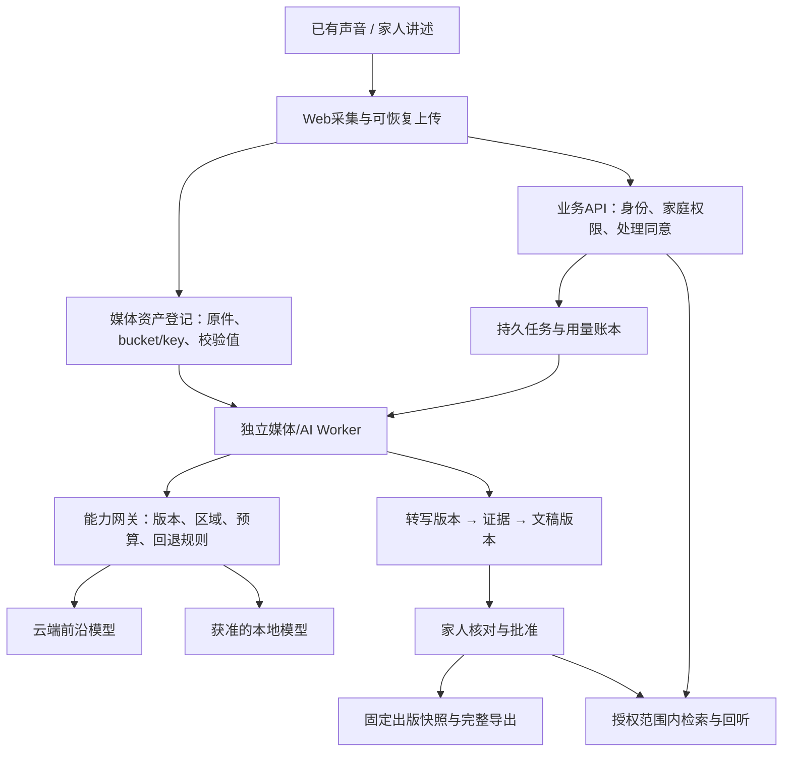
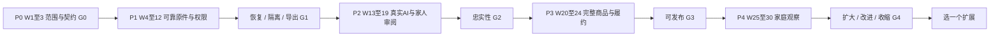

# UR Saga 综合升级实施计划

创建：2026-10-10 · 更新：2026-10-24（Asia/Taipei） · 状态：**G0 里程碑与 P0 修复已达成（`G0 = true`）并推送 GitHub**；下一阶段推进 P1 正式接入与 G1 验收

10月24日本轮[Storage行为预演与7份未登记根迁移对账](research/2026-10-24-storage-behavior-and-migrations.md)：在本地临时 PostgreSQL 17.4 集群中重放私有捕获的 6 个 `storage` 函数与 7 个触发器，RED 4场景/53断言、GREEN 22场景/974行为断言/211观察项、生命周期 4 项极端清理用例全部通过，Task 1 规格审查 `PASS`、质量审查 `Approved`。同时完成 7 份未登记根迁移逐项对账与实际资产路径汇总；负责人确认采用 **方案 B**（`pg_dump` 自定义归档逻辑备份 + 对象存储 SHA-256 冻结清单 + 独立删除墓碑重放 + `pg_restore` 隔离恢复），并明确将供应商样本探针与耗时/账单测算推迟至后续阶段（`deferred_by_user` 至 P2 `T06` 前）。已在本地 PG17.4 完成方案 B 备份恢复、五步幂等前向收敛 SQL 双次重放、应用回退与删除墓碑防复活演练（[`rehearsal-2026-10-24T08-51-18.795Z-380f131c-7974-4690-b297-421575017a6b.json`](research/evidence/2026-10-24-migration-rehearsal/rehearsal-2026-10-24T08-51-18.795Z-380f131c-7974-4690-b297-421575017a6b.json)，5 场景/47 断言通过）。810 项应用输入零变化，接手复核 `npm run verify`（Web 108/1438、180页）通过。至此 §7.1 的 **G0 五项条件与 P0 修复全部达成（`G0 = true`、`p0Complete = true`）**，已按授权推送 `codex/october-upgrade-p0` 分支至 GitHub。详见[本批验证汇总](research/evidence/2026-10-24-storage-behavior/verification.json)与[里程碑判定](research/evidence/2026-10-24-storage-behavior/milestone-check.json)。

10月23日本轮[差距核对与旧删除修复](research/2026-10-23-p0-gap-and-storage-audit.md)：真实只读取得六函数/七触发器且全部指纹匹配，完成静态语义审查；旧故事/文件删除服务及管理员图片删除固定关闭，已上传图片保留引用，纯本地预览仍可移除。采集53项、PG17合成采集34断言/4场景、删除定向3/18；两项实现独立规格PASS/质量Approved。新项目验证Web108/1438、shared4/16、infra7、180页，810输入不变/next-env恢复；收尾见[汇总](research/evidence/2026-10-23-storage-definition-capture/verification.json)。本批没有执行捕获函数的行为重放或真实Storage HTTP，也未改变Public桶/生产配置；正式adapter、迁移回退/备份、供应商账户条件、真实Auth与T01观察仍缺。原型可评审已有证据；P1/G1真机不偷换为G0门槛。原计划第7/7.1节定义不变，未提交/推送/迁移/部署。

10月23日[部署/Auth补充](research/2026-10-23-deployment-config-user-feedback.md)：无隔离测试 Supabase 项目；域名 maxiusi.dpdns.org、commit 1caa21a（升级前基线）、九项变量范围和 Google/SMTP 状态已收到。三项网址与 service-role 提示已补齐：生产 8 个语言回调齐全，Site URL 协议写法、旧邀请链接拼接斜杠及 Secret 存储处理见对账。信息收集已完成，后台调整、真实登录/提供方与 Preview 数据隔离仍待验证；无新部署或生产操作。

10月23日[Supabase用户回传与对账](research/2026-10-23-supabase-user-feedback.md)：A/B/C/D采集完成，无需重跑。两桶均Public、STANDARD、版本控制关闭、生命周期未配置；audio-recordings桶级大小/MIME为null，saga为52428800字节及12种MIME；enum三种标签已补齐，六个函数属性/指纹与10月17日一致。Free Backups未开启，音视频无独立副本，图片副本未单独确认。该用户回传批当时缺少的精确Storage定义审查现由本轮补齐；真实私密访问、迁移回填/回退、备份恢复及账户条件仍缺，P0/G0不变。用户回传批只保存证据并更新交接，其原验证和前批独立审查结论不改写。

前批[PG17组合记录](research/2026-10-22-pg17-rls-source-composition.md)：正常/污染环境各72场景、832个行为断言、236项账本检查及18条真实锁证据；六项兼容RED和四类生命周期均通过。历史矩阵分阶段，最终seed同库组合全部候选；真实Storage/Auth及原质量门仍开放，真机为deferred_by_user。见[验证汇总](research/evidence/2026-10-22-pg17-rls-source-composition/verification.json)和[用户协作步骤](research/2026-10-22-user-action-checklist.md)。

前批[可信来源选择与邀请管理](research/2026-10-21-invitation-management.md)已接通受限SQL/HTTP、共享管理UI及最小请求票据恢复。10月21日PG17 16场景/2448断言、四生命周期，定向5/54、Web105/1420、shared4/16、infra7、180页通过；实现规格/质量Approved。10月22日只读恢复核验确认输入/运行时/日志/清单一致，未重跑测试，见[当前汇总](research/evidence/2026-10-21-invitation-management/verification.json)。来源快照不预留，unknown仅显式查询；生产开关仍关闭。[原质量门判定](research/evidence/2026-10-21-invitation-management/milestone-check.json)沿用第7/7.1节，P0/G0–G4=false，无提交/推送/迁移/部署。管理批文档/整批审查均PASS／Approved、最终完整性通过，下一本地项是PG17的旧RLS/来源账本完整依赖组合，再推进正式媒体/Storage/删除adapter。

以下邀请发送HTTP内容为前批历史，其来源选择/管理UI后续已由当前批本地实现承接：

10月21日邀请发送HTTP续批：[send/release/lookup应用传输](research/2026-10-21-invitation-sender-http.md)已完成本地实现、冻结定向17套/521项和新项目Web101/1373、shared4/16、infra7、178页，785输入不变并恢复next-env。独立规格PASS；质量Approved，文档独立审查PASS／Approved，整批审查PASS，本批本地收尾完成，见[当前汇总](research/evidence/2026-10-21-invitation-sender-http/verification.json)。全局release不以sender lookup为前置；数据库核对当前项目facilitator，UI严格匹配返回身份。旧GET/DELETE/cleanup始终关闭，缺来源/request ID的旧发送明确不可用；完整可信来源选择/发送管理/历史恢复仍待做。SDK/组件合成证据不证明真实提供方、邮件送达或生产资格；前批SQL/依赖/证据未变。原P0/G0–G4仍未通过、历史audit42项未重跑未解决，无提交/推送/迁移/部署。

以下为前批历史。2026-10-21续接：[可信权益事件本地批](research/2026-10-20-trusted-entitlement-events.md)已通过独立规格 PASS／质量 Approved，无待修项，文档独立审查 PASS／Approved、整批独立审查 PASS，本批本地收尾完成。10月20日正常/污染各95场景3,211断言、20并发及4类清理、Web96/1278、shared4/16、infra7、176页构建的原始结果保持不变；本次复核812个源码/依赖/PG哈希、773应用输入、Node和完整文件清单均匹配。见[当前汇总](research/evidence/2026-10-20-trusted-entitlement-events/verification.json)。下一实施接send/release HTTP与发送者恢复，真实事件/角色资格另验；本地输入不证明付款或生产权限，G0/G1=false，无推送。

**已确定：保留现有 Web 与家庭协作基础，围绕“原声可信保存、故事忠实整理、家人容易完成、成果独立带走”做渐进升级。由一名主要开发者按质量门推进，约24–34周；先建立前沿模型基准，再决定扩展能力和降本。**

用户已明确：英语市场家庭；AI 各能力尽量采用 SOTA 候选以减少试错；考虑开放模型与本地部署；“高质量优先，工期较灵活”。2026-10-11确认“D03=A，其他按照推荐”，即D01–D16全部选择A。采用单人资源、渐进升级、少量能力直连、受控云处理、US$59有限范围数字项目、完整档案/PDF、12个月托管及G0–G4质量门。

已确认选择及原有条件见[决策台账](2026-10-10-upgrade-decisions.md)。具体模型ID/账户、渠道、费用上限、商品数量限制与删除能力在P0及相应实施任务中核实；不是重新询问路线。2026-10-11负责人进一步要求补读引用、更新文档并开始实施；当前进入P0，先执行[T00真实AI失败与录音隔离](superpowers/plans/2026-10-11-upgrade-t00-truthful-ai.md)，进度与证据见[基线](research/2026-10-11-upgrade-baseline.md)。后文多人方案与备选路线仅供未来调整时比较。

2026-10-13继续执行：已写出[P0质量门定义](superpowers/specs/2026-10-13-upgrade-p0-gates.md)和[P1数据/迁移契约v0.1](superpowers/specs/2026-10-13-upgrade-p1-contracts.md)，并完成[媒体入口前置批](superpowers/plans/2026-10-13-upgrade-media-access.md)：加固签名回放、ASR和图片上传，最终verify退出0，58套/488项Web测试通过，独立复审的三项问题已关闭。随后完成[T02资产本地批](superpowers/plans/2026-10-13-upgrade-t02-assets.md)与[T05任务状态本地批](superpowers/plans/2026-10-13-upgrade-t05-jobs.md)：T02定向7套/42项；T05先完成8项基础状态测试，再补充幂等输入、人工复核、删除阻断和未知结果受控重试，定向39项、最新全量66套/569项通过。最新实现、兼容边界与验证状态见[媒体入口记录](research/2026-10-13-media-access-implementation.md)、[T02记录](research/2026-10-13-t02-assets-local-implementation.md)和[T05记录](research/2026-10-13-t05-processing-jobs-local-implementation.md)。这些都是本地契约/入口修复，不等于G0已通过、远端schema已核实或T02/T03/T05整体完成。
2026-10-14继续执行：完成[T03权限与删除本地批](superpowers/plans/2026-10-14-upgrade-t03-consent-deletion.md)，新增动作权限、用途同意、删除重试/目标确认和恢复墓碑纯函数；定向12项通过。随后完成[T04录音会话本地批](superpowers/plans/2026-10-14-upgrade-t04-recording-session.md)，新增 MIME/会话/块状态纯函数并将 IndexedDB 升级为 sessions + chunks；定向7项通过，最新全量68套/588项通过。实现与边界见[T03记录](research/2026-10-14-t03-consent-deletion-local-implementation.md)和[T04记录](research/2026-10-14-t04-recording-session-local-implementation.md)。这些仍是本地契约，不等于远端同意/删除表、录音会话/合并任务、RLS、备份、解码或真机恢复已验证。

2026-10-14–15 T04续批：已完成[SmartRecorder本地接入](research/2026-10-14-t04-smart-recorder-local-integration.md)和[恢复预览/浏览器证据](research/2026-10-15-t04-recovery-preview-browser.md)，把实际MIME、登录用户/项目会话、真实SHA-256、先落盘后上传、同项目/账号恢复、回听和本机下载接入录音入口；补传保留本地块，停止等待末块，页面退出及重录按会话隔离；并修复唤醒锁生命周期竞态。恢复批定向3套/44项通过，Chromium本地证据24项通过；本轮新增[服务端合并契约](research/2026-10-15-t04-server-merge-contract-local.md)，固定项目/会话/资产绑定、有序块清单、合并幂等输入和实际解码确认门槛，定向新增9项，当批项目级验证73套/661项通过。当批数据库/Worker/真实解码、真机G1、远端schema/RLS和部署仍未完成；实际本地解码已在下述续批补充。详见[恢复记录](research/2026-10-15-t04-recovery-preview-browser.md)与[合并契约记录](research/2026-10-15-t04-server-merge-contract-local.md)。

2026-10-15 T04 本地执行续批：新增[流式合并与实际解码](research/2026-10-15-t04-local-merge-execution.md)，从可信块清单流式核对原件字节和 SHA-256，再由受限 FFmpeg 进行实际解码；支持常见 WebM/MP4/Ogg 及明确编码参数，失败清理临时产物，原块保留。真实 FFmpeg 集成 56 项检查通过；新增41项回归，最终 `npm run verify` 为75套/702项，类型、lint及175页面构建通过；独立审查的读流释放问题已修复并复审关闭。同时准备[G1 真机执行模板](research/2026-10-15-t04-g1-device-runbook.md)。本地读流目前为注入端口，服务端会话封口、远端 Storage/权限、数据库 ready 写回、独立 Worker 和真机长录音仍未接通。

2026-10-15 T05 续批：完成[本地持久 Worker PoC](research/2026-10-15-t05-durable-worker-poc.md)，使用独立 PostgreSQL 14.17、pg-boss 12.37.1 和 Node 子进程验证事务入队/确认、重复投递、三个阶段进程退出、旧 Worker 迟到、提交中租约过期、跨天批准结果复用和撤权后拒绝发布。基础 PoC 13 个场景 / 125 项断言通过，续批再加入锁行后心跳、未知结果核对及对应失败回归，最终隔离实验为19个场景 / 167项断言；另有项目75套/702项验证；本续批后项目级 `npm run verify` 重新退出0，摘要见 `research/evidence/2026-10-16-t05-heartbeat/verification.json`。复用现有状态 helper，调用账本全部模拟；正式 schema/adapter、生产级心跳/监督、部署与真实账单仍待完成。同时[补核远端只读记录](research/2026-10-15-readiness-refresh.md)：项目身份和GitHub记录已确认，数据库SQL尚未执行、RLS/备份仍缺。G0/G1未通过，本轮不推送。

2026-10-15 依赖修复续批：完成[兼容升级与审计记录](research/2026-10-15-dependency-audit-remediation.md)，Next/eslint-config-next 统一 16.4.1、sharp 0.35.5、Sentry 10.76.2、Handlebars 4.7.10，清除旧 Next peer 和易受影响的嵌套依赖；保留 React/Tailwind/Jest 架构和审计阈值。干净安装、项目 verify（75 套 / 702 项、175 页）、shared（4 套 / 16 项）、infra（7 项）及真实图片/本地 Chromium（18 项）通过。审计从 59 项降到 42 项，critical 从 2 降到 0；34 high / 8 moderate 仍使 audit:high 失败。当日独立审查工具不可用；10月16日已补齐独立审查、运行脚本P2修复及增量复审，见下条。G0/G1未通过，不提交或推送。

2026-10-16续批：完成[T05自动监督与持续任务](research/2026-10-16-t05-supervision.md)，业务/队列同事务心跳、连续消费、有界重启、取消与关闭竞态修复均有真实PostgreSQL故障回归。最终39场景/307项断言；另有真实300018ms合成任务、297次心跳、最大间隔1017ms，同一attempt且一次模拟调用/产物。SIGTERM/SIGINT/异常路径完整回收所属进程及临时数据库；独立复审范围仅为本批。另完成[依赖独立复审与P2修复](research/2026-10-16-dependency-review-followup.md)，4项启动回归和18项运行检查通过；项目verify（75/702、175页）、shared4/16、infra7再次通过。实际审计仍42项（34high/8moderate），远端schema/RLS/备份、供应商资格、正式adapter与真机矩阵仍缺；G0/G1未达成，未提交、未推送或部署。合成持续任务不替代真实长音频或生产托管。

2026-10-16 T04/T05接入续批：实现、本地验证与最终独立复审完成，两处异常回收P2均已关闭：[真实本地文件合并与持久Worker](research/2026-10-16-t04-t05-local-merge.md)，冻结清单/幂等绑定、可取消读流与实际FFmpeg、唯一私有输出回读、受保护发布事务及受检读取已接通。真实合并52场景/396项断言、原T05回归39/307、实际解码异常清理6/6、观察器自身故障清理3/3，项目verify75/716与175页、shared4/16、infra7通过；所有最终运行源码指纹匹配。崩溃或COMMIT未知保留私有孤立文件，防止误删可能已提交结果；本批不实现孤立GC/自动复用或正式Storage adapter。节流解码及检查点等待有明确标注，不替代G1真机5/20/30分钟矩阵。远端证据、供应商资格及原质量门仍缺，未提交、推送或部署。

2026-10-16 T05错误分类续批：完成[已知本地合并错误与原子重试](research/2026-10-16-t05-merge-failures.md)的R1修复后实现与本地验证，独立复审已关闭R1，没有新增Important/Critical问题。明确源错误及PCM/时长校验失败进入failed，暂时源读故障沿原预算有界退避；失败审计/业务状态/延迟消息/旧消息确认同事务，取消与租约/输入/队列fence保持。通用FFmpeg退出/诊断按R1裁定保持未知，部分损坏音频需后续核对；准备后或未知COMMIT继续隔离、保留私有输出；回收契约已写，自动GC未实现。最终故障42/371、完整合并52/402，项目verify76/730与175页、shared4/16、infra7通过；两个新集成报告指纹/清理匹配。原T05回归39/307在R1修复前执行，其实际执行源码未改，旧附带合并场景哈希不当当前证明。审计仍42项（34high/8moderate），远端前置及G1真机仍缺；原G0/G1未达成，未提交、推送或部署。

2026-10-16 T05输出生命周期续批：完成[私有输出候选与发布互斥](research/2026-10-16-t05-output-candidates.md)的实现、本地验证及独立审查，规格/质量均PASS，无Critical/Important/Minor发现。输出创建前持久登记身份，准备后存metadata，独立publishing意图保护未知提交，published与业务/attempt/queue原子提交；读取和quarantine共用身份及发布约束。明确停止且无引用/未知状态的prepared候选才可登记quarantined，尚无物理GC；outcome_unknown后取消继续保留。候选45/277、真实合并52/402、失败42/371、原T05 39/307均本批通过并核对源码/清理；项目verify76/730与175页、shared4/16、infra7通过。依赖未改，沿用前批实际audit42项；远端元数据/供应商资格/正式adapter/G1真机仍缺，原里程碑未达成，未提交、推送、迁移或部署。

2026-10-17 G0/T02续批：完成[远端元数据对照](research/2026-10-17-remote-metadata-reconciliation.md)，已取得43个表/视图、459字段、79策略及4条迁移版本；7个本地增量未登记但其声明表已存在。发现audio全桶读/上传、saga路径误绑定及撤权规则、stories并行许可和jsonb[]/角色CHECK差异，须先隔离演练修复再接正式adapter。bucket配置仍42501；备份/对象/供应商/真机仍待验收。采集器10项、Web76/730、shared4/16、infra7及175页构建通过，实际audit42项仍失败。G0/G1未达成，未提交/推送/迁移/部署。

2026-10-17 RLS续批：完成[Storage/stories隔离演练](research/2026-10-17-rls-rehearsal.md)，重放快照32条策略，完整依赖先出现42P17；依赖隔离诊断复现五类宽松授权/路径绑定行为。统一当前成员helper及RESTRICTIVE候选在本地PG14通过61场景/199断言，原子回滚、重复应用及单独SIGTERM清理均有证据。候选拒绝旧直接删除/覆盖，未验证PG17、Storage HTTP、完整远端依赖或生产adapter；REPEATABLE READ旧快照仍保留撤权前视图。项目verify76/730、shared4/16、infra7和175页构建通过，audit仍42项。独立审查因模型限流待补，不当作PASS。生产RLS未改，G0/G1仍未达成，未提交/推送/迁移/部署；下一步补审查、bucket/函数/触发器/ACL/历史等价与兼容迁移/备份回退。

2026-10-17 T02兼容与审查续批：完成[旧媒体来源投影/schema兼容](research/2026-10-17-t02-legacy-mapping.md)，修复标准Storage URL误认bucket及路径归一化，保留jsonb[]/照片旧字段的逐来源定位、原件/缩略图/派生区分、冲突与异常项；mapped不当资产ready。定向2套/40项、真实PG兼容19项及SIGTERM清理通过，来源账本/回填/回退草案已写，正式账本和adapter未接通。前批[RLS独立审查修复](research/2026-10-17-rls-review-followup.md)补齐Unicode首尾空白与分配/中断竞态，63场景/351断言和6类清理通过；两个runner显式隔离宿主PG环境。初次审查提出的问题已修复，最终增量复核状态见[本批汇总](research/evidence/2026-10-17-t02-compatibility/verification.json)。项目verify77/765与175页、shared4/16、infra7通过；依赖未变，本批未重跑audit，沿用前批42项失败证据。生产权限、bucket/完整元数据/历史对账/备份回退、供应商/正式adapter/真机仍缺，G0/G1未达成，未提交/推送/迁移/部署。

2026-10-17 T02账本与元数据续批：完成[来源账本与原子绑定](research/2026-10-17-t02-source-ledger.md)，来源完整字段/类型摘要、只追加版本/核查/绑定、项目权限/墓碑/资产复查及未知COMMIT核对在本地PG14通过；初审“移除来源未入账”P2先RED再修复，最终290项/18锁证据、宿主环境与SIGTERM清理通过，独立增量复核PASS。前批T02环境P2复核已补齐；[采集器P2修复与函数/触发器/ACL补核](research/2026-10-17-metadata-supplement.md)23项及独立复核通过，单次远端PG17只读采集取得39函数/156执行权限/21触发器/8 schema权限/9默认ACL，原11节未变、bucket仍42501。两邀请RPC签名不兼容、public函数EXECUTE/SECURITY DEFINER语义需审查，完整函数体/迁移等价未确认。项目verify77/765及175页、shared4/16、infra7通过；应用/依赖/根迁移保持，audit沿用前批42项失败。生产权限、备份/回退、正式adapter、供应商和真机仍缺，G0/G1未达成，未提交/推送/迁移/部署。

2026-10-17 RPC核查续批：完成[12个受限函数真实定义与调用契约审阅](research/2026-10-17-routine-audit.md)。采集器两项本地测试P2已修复并复核，52项通过；单次只读PG17采集12/12摘要/属性匹配，私有正文0700/0600，远端未调用。13处应用调用中5处邀请参数不匹配；真实定义确认通知身份缺口、付款来源/初始化NULL检查、缺列/角色约束与结账/导出占位。两个通知函数在隔离PG16精确重放，正常/污染环境各19场景181断言，实际SIGTERM143和启动失败清理通过；候选仅限本人并收紧EXECUTE，独立规格/质量审查均PASS。应用verify77/765及175页、shared4/16、infra7通过；依赖未改，audit沿用前批42项失败。生产权限/兼容迁移、完整依赖/历史等价、bucket/备份回退、供应商、正式adapter及真机仍缺，G0/G1未达成，未提交/推送/迁移/部署。

2026-10-18 PG17续接：[依赖核查与持久导出请求](research/2026-10-18-pg17-routines.md)已补唯一已知更新时间触发函数并构建原生17.4，固定采集器69项及独立审查通过。相关7表/70字段/34约束/34索引/3触发绑定已重建，12原RPC逐重载运行，区分缺列、名称歧义、身份缺口和无持久记录的导出占位。两个本地导出候选只在本人/当前项目授权及请求行写入后返回ID；queued不表示文件已交付。原解码测试维护38项及独立审查通过，生产解码不变；本批应用verify77/766、shared4/16、infra7、175页构建已通过，续接核对707个输入一致。PG17最终正常/污染环境各141场景874断言、12锁证据和4类生命周期验证通过，规格/代码及整批复核均PASS，见[交接](HANDOFF-2026-10-13-upgrade.md)。原生PG17不等于Supabase认证/RLS/Storage环境；邀请/支付/历史兼容、bucket/备份/供应商与正式adapter/真机仍缺，G0/G1未通过。

2026-10-18 RPC权限续批：[邀请兼容核查](research/2026-10-18-invitation-compatibility.md)确认五处参数/身份/TABLE差异与token、取消/过期、余额来源缺口；Task 1独立审查PASS。[接受/创建本地候选](research/2026-10-18-rpc-access-guards.md)保留原签名，接受按首次读取绑定及锁后当前资格拒绝越权，创建在既有钱包锁下原子消费1券/1对应席位并写两条consume，payment_status明确unverified。初审改绑P2经真实RED、修复后正常/污染环境各117场景1834断言、26次锁等待及4类清理通过，Task 2修复复审两轴PASS；旧116/1828及初审证据原样保留。单次绑定一致性不提供历史/ABA不可变保证，更强保证需要另行可信版本/映射设计；无幂等键，不保证重试去重。控制器本轮verify77/766、shared4/16、infra7和175页通过，707输入复核未变，依赖audit仍42项；Task 3文档/完整性核验完成，[最终整批独立审查](research/evidence/2026-10-18-rpc-access-guards/batch-final-review.md)通过，见[汇总](research/evidence/2026-10-18-rpc-access-guards/verification.json)。正式token/确认邮箱/持久预留、钱包/支付来源、生产认证/ACL/RLS/Storage、历史等价、bucket/备份/供应商/真机仍缺。G0/G1未达成，未提交/推送/迁移/部署，本批不是新里程碑。

2026-10-18邀请事务续批：[隔离token与持久席位候选](research/2026-10-18-invitation-transactions.md)实现send/accept/release/status/lookup、规范token、保护绑定/请求去重、钱包和合成可信来源原子预留/返还及严格TABLE解包。正常/污染环境原始最终执行各158场景2,288断言、33实际并发场景、282完整状态核对，协议18/18和4类清理观察通过；24直接输入、44依赖/package、743PG文件、Node/pins及27份原实现证据哈希复核一致。Task 1独立规格PASS、质量Approved，无发现；Task 2独立审查PASS/Approved；整批独立审查已PASS，见[当前汇总](research/evidence/2026-10-18-invitation-transactions/verification.json)。本批应用未重跑，复用前批RPC权限在12:24:38.969365—12:26:48.304226 Asia/Taipei实际执行的77/766、shared4/16、infra7、175页结果，707输入/3日志及next-env起点字节一致。合成确认邮箱/权益端口不等于生产JWT或付款验证；正式adapter、旧RPC/直接表/旧UI/API旁路与签名兼容、历史token映射/前向回退、生产权限/迁移/Storage/备份/供应商/真机仍待完成。audit仍42项失败，G0/G1未达成，保留本地分支和未提交内容；未提交/推送/迁移/部署。

2026-10-18邀请HTTP续批：[接受/状态适配](research/2026-10-18-invitation-http-adapter.md)已替换两个旧HTTP接受handler，facade改用session Bearer的HTTP helper并保留data包装、project_id/role。仅精确开关true启用，默认503且零外调、无旧写回退；历史opaque token/Cookie-only接受不支持。同一已验证client执行status→至多一次accept，最终确认才成功；unknown只能显式只读恢复，无自动写重试。定向三套共 194 项通过；handler 测试使用实际 SDK 对接合成 loopback；首次完整verify空fixture套件失败保留，移动fixture/三处import修复后Task 1独立PASS/Approved。控制器本批新运行Web80/960、shared4/16、infra7与176页通过，715输入及next-env保持，见[当前汇总](research/evidence/2026-10-18-invitation-http-adapter/verification.json)。Task 2独立审查PASS/Approved；最终完整性及整批独立审查已通过，M1已修正并复核。真实Auth/JWT/PostgREST/PG17集成未验证；可信权益source/event、发送/旧读取/直RPC/表旁路、历史兼容迁移回退及原G0/G1仍缺。audit42项未重跑且未解决，构建旧警告仍在；未提交/推送/合并/迁移/部署。

2026-10-19邀请只读/UI续批：[旧token GET兼容与恢复页面](research/2026-10-19-invitation-read-ui.md)已接原Bearer只读status；精确true才启用，check-pending始终503，不再直表或GET改expired。两页面共享显式接受/unknown查询恢复，身份代次使同一React batch离开/返回账号后的旧响应失效；初审I1及真实RED保留，修复限定复审Approved。最终253项为18新读取路由SDK＋41 React＋194既有回归；控制器固定代码后新运行Web82/1019、shared4/16、infra7、176页通过，751输入未变、next-env恢复，见[当前汇总](research/evidence/2026-10-19-invitation-read-ui/verification.json)。Task 2文档独立审查、整批独立审查及最终完整性均已通过。pending/可信最小预览及历史opaque token仍不可用；signin/callback旧日志与auth_next持久化为独立发布阻塞。可信权益source/event、发送/取消、直接RPC/表ACL、真实提供方集成和历史迁移回退仍缺，合成SDK/UI证据不证明生产权限。audit42项/构建旧警告未解决，G0/G1=false，无提交/推送/迁移/部署。

2026-10-19认证回跳续批（历史）：[安全目标与旧状态清理](research/2026-10-19-auth-return.md)已完成安全next、auth_next只删不读、strict signin/有界callback及保留cookie的303；430项和当时Web85/1196通过，任务/整批审查及完整性通过。其默认implicit/localStorage兼容阻塞和“先做会话衔接”建议是当时状态，已由下一批本地实现承接；原研究与证据不改写。

2026-10-19认证会话衔接续批（当前）：[本地实现](research/2026-10-19-auth-session-integration.md)已统一浏览器PKCE/cookie与provider核实的store/SSR/Bearer；关闭SDK自动URL处理，补完整session OTP、生命周期和同用户刷新时页面连续性。只精确删除旧localStorage认证key、不导入凭据，旧缓存用户须重新登录；保留裸`?type=invite`原链接指引，拒绝旧fragment-only和畸形callback，safe next/丢next回dashboard不变。两轮独立审查的五项问题已修复：规格复审PASS、质量复审Approved且无新规格问题；最终28套/605项、Chromium14项通过。控制器新Web96/1278、shared4/16、infra7、176页通过，773输入不变且next-env恢复；[当前汇总](research/evidence/2026-10-19-auth-session-integration/verification.json)已记录文档独立审查、整批独立审查与最终完整性均已通过。

RB1本地根因修复与合成集成已完成，真实Google/SMTP、完整Next/域名cookie部署、JWT/RLS/PostgREST资格仍开放。下一独立本地实施为可信权益source/event供给、撤销/持久去重、send/release与直接RPC/表ACL；真实提供方资格单独验收。旧RED、harness失败与两轮修复证据均保留；audit42项（34high/8moderate）未重跑未解决。构建仍有旧Next配置及缺服务端key的configuration-validation诊断，成功build不证明生产合格；G0/G1=false，无提交/推送/迁移/部署。

## 1. 回顾结果与依据

T01/B01更新：已完成[两入口本地原型](prototypes/2026-10-13-two-entry/index.html)与[6–8户观察脚本](research/2026-10-13-t01-study-guide.md)。导入、邀请返回原问题、中断恢复、上传/整理失败、来源分歧及批准/下载边界已完成85步浏览器演示验证（含7次预期拒绝），规格及质量审查通过。实际家庭观察0户，原型不连接真实存储、录音或AI；[实施与证据](research/2026-10-13-t01-prototype-implementation.md)不替代T04/T08/T09生产验收。B01的原型与研究准备完成，真实研究部分继续待办。

2026-10-13新增执行约束：负责人要求“暂不部署，等完成里程碑再统一部署”。后续批次继续本地开发与验证，不逐批部署、不推送触发部署、不执行远端迁移；达到相应里程碑并完成发布证据后再统一安排。单个修复批或原型完成不等于发布里程碑，G0设计门也不自动授权上线。

2026-10-15新增执行授权：继续推进并更新 handoff；若达成本计划现有里程碑则推送 GitHub。推送前逐项核对质量门，不能把新增本地批次当作里程碑；不自动授权合并 main、生产迁移或提前部署。

### 1.1 原会话的有效上下文

已读取引用会话的全部六轮记录，包括失败/中断轮、用户澄清、主要答复和产物路径。其演进为：

1. 10 月 7 日：用户担心项目过时，要求产品、体验、技术、商业综合调研；随后确认英语市场家庭。
2. 10 月 8 日：用户指出竞品来源过窄，要求 Facebook、Instagram、Threads、X、Reddit 证据；报告增加“已有声音”和“陪同讲述”两个待测任务，明确仍推荐英语市场。
3. 同日：用户要求跳出现有架构和供应商，研究未来 AI 架构、高中低组合。
4. 随后：用户明确 SOTA 优先并考虑本地部署；新版 AI 报告取代“Nova-3＋便宜模型先行”的推荐。
5. 最后一轮综合计划请求因服务错误未完成。本轮承接该请求，并加入用户新确认的质量优先偏好。

仓库还存在一套旧综合计划及配套执行文件。部分文档声称来自另一条 `/grill-with-docs` 指令；本次引用会话不能验证那条指令及其授权范围。因此不裁定其历史来源，但本轮按用户“让我最终决定”的明确要求重新标注决策状态。

### 1.2 各类证据应该承担什么结论

| 证据 | 可支持的判断 | 不能据此认定 |
|---|---|---|
| 当前代码，HEAD `1caa21a72` | 已有结构、实际调用、缺失路径 | 生产已部署、数据未丢失、用户已验收 |
| 10 月 7–8 日官方商品/API/模型材料 | 当时的商品、能力、费用与许可线索 | 本日账户能调用、合同满足要求、Saga 实测最强 |
| 7 条可直读社交原帖及部分回复 | 原声保存、开始困难、陪同、不同记忆的假设 | 代表性需求比例、国家排名、愿付价格 |
| 10 个 Reddit 家庭讨论串索引 | 访谈线索与正反例 | 已阅读全文、已核实订单 |
| 成本脚本与 JSON | 给定输入下可复算的预算 | 实测成本、全部运营费用、商品售价 |
| 旧“完成/部署”报告 | 历史工作记录和待核检查项 | 本轮新功能已完成、真实生产验收通过 |

本轮补充[代码实施差距审计](research/2026-10-10-implementation-gap-audit.md)与[证据及产物核查](research/2026-10-10-evidence-and-artifact-review.md)。前者检查代码，后者登记来源笔记、成本工具和旧计划配套产物；主报告、体验、商业和社交综合研究由本计划整合。覆盖原会话产物，不声称对旧长计划的每一段示例代码完成逐行审查。原研究继续保留，不覆盖用户已有改动。

2026-10-11补读已完成根PRD、旧战略全文及配套资料，具体覆盖见[资料补读记录](research/2026-10-11-reference-review.md)；七份AI/本地专题与所列官方页面的新增核查见[供应商准备记录](research/2026-10-11-provider-readiness.md)。后者更新公开ID、价目和数据条件，未做账户调用；社交原站未重新核实。根PRD已消除虚假录音保证、默认原声删除、隐私承诺代认证及强制NPR/公开流程等冲突。

### 1.3 相比旧计划的关键修正

| 旧文件中的问题 | 本计划的处理 |
|---|---|
| “项目负责人已决策”、固定 8 周生死线 | 改为可选择方案；以质量门与真实样本成熟度推进 |
| 美国 70% / 其他地区 30% | 无需预设国家配额；优先实际可触达的英语家庭 |
| 把 AWS / Temporal 架构参考当迁移指令 | 先验证现有底座，新增独立 Worker；采购由 D07 决定 |
| 用模型名称和榜单代替产品质量 | 前沿候选先建立基准；以自己的保留测试集决定发布 |
| 示例代码被当成能照抄的实施方案 | 任务按真实文件与接口拆解，先小范围设计、验证再合并 |
| 引用匹配不到就关联整段转写 | 明确标为未匹配，不允许产生虚假出处 |
| 免费、折扣与付费家庭混算；推荐率当 NPS | 统一家庭分母、观察窗、净实收、人工和退款口径 |
| 只统计完成家庭的成本 | 成本覆盖整批参与者，再计算每个付费家庭和每个完成家庭的分摊 |
| 文档路径和生产网址有占位/失配 | G0 核对真实环境、迁移和发布证据，禁止按旧快捷清单盲执行 |

## 2. 产品目标与边界

### 2.1 已确定的产品定位

面向愿意保留亲人记忆的英语家庭，提供一个私密空间：**先留住一段声音，再把值得继续讲的故事整理成家人认可、可以回听和保存的作品。**

核心不是“生成更多传记文字”。与手机录音＋云盘相比，需要证明少了寻找、组织、核对、排版和交付的劳动；与已有家史产品相比，需要证明特定家庭在 Saga 上更容易完成。可靠与可追溯首先是交付标准，尚不能宣布为已验证的市场壁垒。

四个角色分别设计：讲述者负责表达与同意；组织者负责邀请、整理与购买；家庭听众负责回听、补充和追问；运营人员只在明确授权下帮助交付。购买者不是所有讲述内容的无限权利人。

### 2.2 本轮升级的完整范围

| 必须达到发布标准 | 同一底座上的受控扩展 | 以后按独立证据决定 |
|---|---|---|
| 原件、恢复上传、明确保存状态 | 老照片辅助提问与 OCR | 自主实时语音主持 |
| 真实 ASR、来源与版本 | 人物/日期/关键词/语义查找 | 原生后台录音、电话采访 |
| 家人核对、分歧和撤销分享 | 多篇故事集与可读 PDF | 中性旁白、有声书精修、视频理解 |
| 私密权限、删除、完整导出 | 英语购买者中的单一跨语组合 | 机构私有部署、公共档案、声音克隆 |
| 统一商品、履约状态、成本记录 | 本地模型的隔离评测路线 | 公共 Wiki、生成式纪念视频 |

两入口共用模型、媒体、证据和出版流程：A“整理已有声音”先贯通内部技术链；B“和家人讲一段故事”补齐录音体验后进入试点。开发顺序串行，试点分别比较两种用户任务。D04=A已确定首期支持音频与照片；视频提取音轨、全视频语义处理均留待后续验证。跨语组合、本地模型评测属于受控扩展，不增加首版发布依赖。

### 2.3 三种升级路线

| 路线 | 交付深度 | 主要代价 | 判断 |
|---|---|---|---|
| A 有人协助的验证版 | 基础安全保存与导出；人工整理代替部分自动化 | 运营劳动高，难据此判断自助体验；仍须满足数据底线 | 预算有限的备用路线 |
| **B 渐进升级完整闭环** | 录音、证据、审阅、出版、检索、付费与可维护后台 | 需要持续工程、真机与家庭测试 | **已选；对应决策台账D02=A，本表路线字母独立** |
| C 平行重建平台 | 新后端/存储/认证或云平台，加数据迁移 | 双系统、权限迁移、回滚成本，延后家庭验证 | 仅当 G0 证明现有约束无法满足要求 |

高质量不要求先重写全部系统，也不要求一次加入所有能力。优先把完整链上的错误和返工减少，再扩大链条。

## 3. 当前基础与必须优先解决的差距

| 领域 | 现状 | 升级动作 |
|---|---|---|
| 框架 | 本地已升级 Next.js 16.4.1，保留 React 19、TypeScript、Supabase | 按安全/兼容需求维护；本地版本不等于已部署版本，审计剩余项见10月15日依赖修复记录 |
| 家庭空间 | 项目、角色、邀请、故事、Agent 产物可复用 | 在实际入口验证角色与对象权限 |
| 媒体定位 | 主录音写入 `audio-recordings`；ASR已改为默认同桶、旧`saga`显式传入；删除仍构造另一条路径 | `MediaAsset` 保存真实 bucket/key；所有读写删除统一按资产 ID 找对象 |
| 录音恢复 | 有分块、失败块 IndexedDB；会话信息/云端重组与恢复入口未闭环 | 持久会话目录、先落本机再上传、最终清单校验、恢复界面 |
| 转写 | 主路径依赖浏览器识别；未形成原件驱动的可靠后台 ASR | 服务器档案转写为真源；浏览器字幕只能是临时辅助 |
| AI | Editor/Interview主要规则模板；T00已移除AIService随机/模板降级并校验响应，录音页显示真实整理状态 | 继续建设持久处理、统一能力网关与事实/来源校验；当前回归不证明模型质量 |
| 出处 | 已有引用/偏移，没有完整音频时间、转写版本和审阅流程 | 版本化证据链、原声定位、引用校验和人工决定 |
| 导出与删除 | 用户入口/文件覆盖不足；删除路径和账号入口不完整 | 资产驱动导出/删除工作流；另一设备离线验收 |
| 商品 | Waitlist 与多套历史套餐并存 | 一份商品真源、授权权益、履约和退款状态 |
| 部署 | 历史报告含通过声明，也有待迁移和占位 URL | 在受控环境重新建立可复查基线 |

以上结合10月10日静态核查、10月11日T00及10月13日媒体入口变更，不宣称已发生数据泄露或实际丢失。签名回放的`/projects/`子串放行及ASR对象授权缺口已在本地API修复；直接Storage RLS、历史对象映射、用途许可与完整删除仍是T02/T03发布阻塞项。历史基线见[10月11日记录](research/2026-10-11-upgrade-baseline.md)，当前实现及验证见[10月13日记录](research/2026-10-13-media-access-implementation.md)。

## 4. 目标体验

### 4.1 讲述者

打开邀请后先看到“谁邀请我、想问什么、谁可以听”，完成必要认证后直接回到这个问题。首页只保留开始、暂停、结束与跳过；问题常驻，不要求理解 Agent、项目席位、模型等级或公共档案。

录制中持续显示录音状态、此设备保存状态、云端确认状态。中断后显示实际已保存范围和可恢复动作。系统没有收到音频时不显示“已安全保存”。不能承诺浏览器在锁屏、系统杀进程或本地数据被清理后仍保留尚未落盘的内容。

完成后先试听原声，再显示“文字整理中”。对旧记忆支持未知日期、约某年、某年代，录制时间单独保存。不强迫把生日留言或笑声扩写为文章。

### 4.2 组织者与家庭审阅

组织者可选择一个旧音频或一个问题/照片；邀请状态、录音状态、需要确认的事项分开。审阅默认先处理姓名、关系、年代和说话人，再看文稿风格。点击一句话可听对应原声；用户可以接受、修改、保留分歧、暂时跳过。

“讲述者记得如此”与“已获得外部证实”分开。家庭成员的补充有自己的署名和来源，不覆盖他人的记忆。模型只建议编辑，不自动发布、不修改权限、不认定亲属关系。

### 4.3 首份成果

每个成果含原声回放、背景、校订文字、来源和可下载文件。小故事集增加封面、目录、照片、PDF；网站中的二维码可辅助回听，但导出不能依赖二维码网址永久存活。

下载包包括原始媒体、兼容播放副本、文字、图片、版本/授权摘要、文件清单与校验值、无需启动服务器即可打开的目录。目录数据直接嵌入安全转义的页面；不依赖 `file://` 下跨文件 fetch，不把用户内容未经转义塞进 HTML。

### 4.4 体验验证范围

至少覆盖 iPhone Safari、Android Chrome、桌面浏览器；邮件/短信中的邀请往返；键盘、放大、屏幕阅读器；低数字熟练度、慢语速和需要陪同的人。自主完成与家人陪同完成分别报告。

正文和按钮尺寸先以可读、易点按为设计起点，再做实际观察；WCAG 2.2 AA 是验收参考。不会把建议的 44–48px 点击区误写成 AA 的统一最低要求。首屏、录音、恢复、审阅、导出各有一套原型；先观察 6–8 个家庭，再固定交互。

## 5. 技术与数据设计

### 5.1 已确定的架构

**优先实现**：Next.js 继续负责产品和业务 API；Supabase Postgres/Auth 可复用；私有对象存储先保留并清理路径；长任务移至独立容器 Worker。FFmpeg 处理转码、合并、校验，Python 仅在媒体/本地模型生态确有便利时采用，业务权限保持服务端统一。

D07=A已确定首轮持久任务表＋成熟队列/Worker，必须拥有租约、重试、死信、幂等、取消、观测和恢复。P0验证代表性恢复场景；只有证据表明需要大量自研恢复逻辑时，才提出托管工作流的调整方案。用户审批跨天保存为业务状态，不让一个 HTTP 请求或进程等待家人几天。

10月11日官方材料复核后，在A内先做pg-boss＋Node Worker PoC，Supabase Queues作为替代；仍须固定部署版本、连接方式与供应商条件，完成四类恢复测试。当前尚未安装或部署队列；不将成熟队列的投递保证解释为外部模型恰好一次收费。

不默认自建 GPU 集群、Kafka、Kubernetes、专门图数据库；关系表先存人物/事件关系。高质量工程重点是持久数据、正确权限、故障恢复和可回滚的版本。

### 5.2 最小领域对象

| 对象 | 必要字段或约束 |
|---|---|
| `MediaAsset` | family/project、owner、真实 bucket/key、mime、hash、duration、状态；原件与派生件互相可追溯 |
| `RecordingSession/Chunk` | 设备会话、项目、顺序、实际 MIME、hash、落盘/上传/完成状态；完成清单不能只信前端 |
| `TranscriptVersion/Segment` | 版本、语言、模型、说话人标签、时间、人工更正；保留输入资产版本 |
| `Assertion/Person/Event` | 陈述、讲述者、来源段、时间精度、确认状态；不同记忆允许并存 |
| `StoryVersion/Publication` | 文稿、段落出处、批准人、固定版本；模型升级不改已发布作品 |
| `Consent/AccessGrant` | 谁授权、用途、素材范围、版本、撤回；家庭分享与公共贡献分离 |
| `ProcessingRun/Usage` | 幂等键、输入/配置版本、供应商请求 ID、耗时、用量、错误、重试、费用 |
| `DeletionRequest/ExportJob` | 目标资产、派生对象、存储/索引/供应商状态；失败可追踪，完成可核验 |

不直接把新表名复制到生产。先盘点现有 schema，复用 `agent_runs`、故事元素等结构，通过新增字段或映射迁移。旧记录没有可靠时间戳时标记“历史来源未对齐”，不能伪造补齐。

### 5.3 五项工程契约

1. **保存契约**：块先持久化，服务端确认对象和清单完整后再显示云端保存。只有最终资产验收后按保留规则清理恢复草稿。崩溃恢复必须检验容器能解码、顺序和时长正确。
2. **任务契约**：音频保存与 AI 成功解耦；API 返回任务 ID。幂等键包含资产/转写版本、处理器/提示词/模型版本和配置。外部调用结果未知时先查询/复用，设有界重试，不声称能保证第三方收费恰好一次。
3. **来源契约**：模型输出已分配的 segment ID；服务端检查 ID、引用文本、时间范围与版本。找不到引用则拒绝该证据关联、标注待确认，绝不回退到整段作为“已验证”。
4. **变更契约**：转写更正触发相关证据、索引和草稿失效；人工批准内容不被后台覆盖。新版本以修订建议呈现，已发布版本保持快照。
5. **访问契约**：客户端传 asset ID，服务端重新按真实对象查权限。导出、ASR、检索、删除、Worker 回调都检查同一项目边界；签名链接短期有效，下载之后的副本无法远程收回，撤销分享时明确这一点。

### 5.4 迁移、备份与发布

采用新增结构→回填→影子读取比较→小批切换→观察→关闭旧写入的顺序。回填保留旧 ID 与对象地址映射，记录无法定位的文件；未确认完整前不删除旧数据。根 `supabase/migrations/` 与历史 SQL 的执行情况在 G0 核实，形成唯一迁移入口，不照抄错目录命令。

数据库备份与媒体对象备份分别验证；“数据库有备份”不代表音频也有。建立脱离主服务凭据的恢复副本或等效隔离，演练单对象误删、数据库恢复和部署回滚。建议正式发布前以受控单故障测试验证已确认云端保存对象零损失、恢复到可访问状态不超过 4 小时；这是拟定目标，G0 按规模与服务能力确认后才形成承诺。

发布通过功能开关逐步开放：内部测试→受邀试用→小批付费→扩大。回滚关闭新处理与新写入，保留原件、已完成任务和数据映射。删除申请形成墓碑记录，恢复备份后重新应用，防止已删内容复活。

## 6. AI 选型、评测与本地路线

### 6.1 继承最新报告的候选，不继承未经实测的胜者结论

下表继承10月8日报告候选；10月11日对所列官方型号、基础价目与数据条件的补查见[供应商准备记录](research/2026-10-11-provider-readiness.md)，不是Saga质量实测。接入前仍须核实账户、区域、训练退出、保留/删除与实际账单。Voyage零留存/训练退出有支付及管理员配置条件，ElevenLabs企业ZRM/区域有资格限制，Anthropic模型回退不能沿用未经核验的数据条件；任何一项不满足就选择合格替代。

| 能力 | 第一条基准 | 对照/扩展 | 发布前证明什么 |
|---|---|---|---|
| ASR、词时间、分离 | Scribe v2 | 特定难例 Step；本地 Qwen/Parakeet/Voxtral | 专名、年代、慢语速、多人归属和可回听时间 |
| 提取、编辑、照片 | Opus 5.5 | 一个针对失败类型的挑战者；之后 Sonnet 降本 | 少新增事实、保留语气、可解析、家属少返工 |
| 证据复核 | 确定性校验＋Astra＋家人 | 删除复核步骤的消融对照 | 真能找到植入错误，误报不淹没审阅 |
| 检索 | 人名/日期/全文＋Voyage 4 large / rerank-3 | 先比较关键词基线；本地 embedding/reranker | 权限内召回、出处正确、没有资料时说明 |
| 实时采访 | 家人主持＋文字追问先成为正式能力 | GPT-Live 1＋Astra 的独立原型 | 等待、打断、回声、弱网、有效新增故事 |
| 中性旁白/视频 | 本轮不作为发布依赖 | Eleven v4 Turbo；Gemini 视频候选 | 实际需求、忠实性、素材来源与总成本 |

每项能力先接一个合格基准，具体失败才增加一个挑战者；不做所有供应商的排列组合。高、中、低档是内部路由与预算方案，不是对家庭出售的模型等级。

### 6.2 评测顺序与指标

**E0 管线验证**：5–10 个虚构/授权困难片段，包含静默、重叠、错误日期、自我纠正、同名人物、重复上传。先检验真实调用、解析、出处和用量，不急着扩样本。

**E1 任务质量**：取得单独评测授权的 20–30 位讲述者、每位 10–20 分钟素材。开发集与保留集按家庭/讲述者划分，防止同一人或正确答案泄漏。记录设备、口音、噪声与陪同方式。先定义严重错误与正确参考，由人工核听；模型裁判只做辅助。

**E2 端到端盲审**：同一素材对高档基准与一个候选随机隐去模型名，比较人名/年份/主体错误、遗漏、来源定位、讲述者认可、家庭修订分钟和运营劳动。测模型复核有无增益，不把两家供应商当作天然独立真相。

**E3 每次升级回归**：固定数据/提示/参数/模型版本，保存原结果；新模型、量化、分片或检索改动均重跑相关集。严重错误未解决不发布；高档质量达标后才比较中档。低价不构成放宽数据条件的理由。

量化门槛见 G2。WER 与通用榜单作为诊断指标，不能取代关键事实错误和修订劳动。20–30 人不能证明全部英语国家或所有老年人均适用。

### 6.3 本地部署是一项独立决策

| 路线 | 可获得的价值 | 代价与边界 | 建议 |
|---|---|---|---|
| 云端高质量基准 | 快速知道当前能达到的效果 | 资料交合格处理商，须明确数据条件 | 先建立参考 |
| **云端＋本地受控 Worker** | 媒体处理与可替换模型在受控环境 | 发送转写到云端仍是资料出站 | **推荐，先试一条本地链** |
| 全离线产品 | 特定家庭/机构要求不出边界 | 模型、检索、日志、备份、回退均本地；质量与维护成本更高 | 有明确硬要求时独立立项 |

Apple 设备先按实际内存选择 Parakeet/Qwen 小模型＋轻量检索；大内存 GPU 才评估 Voxtral/更大文本模型。32GB、64GB、24GB 显卡的可用容量不按权重文件大小保证。具体许可、量化和运行时见[本地专题](research/2026-10-08-ai-local-deployment.md)。

先用已有设备或有上限的租赁完成一次吞吐/质量/内存/离线出站检查，再决定采购。云基准与本地同一保留集比较，算硬件折旧、电力、运维、闲置和人工，不把开放权重当免费服务。默认本地 PoC 为可选任务，不能阻塞主闭环；若 D08 选择“资料绝不出设备”，则重排为前置依赖并重新估时。

## 7. 分阶段实施与质量门

执行基准按 **1名主要开发者、每周约4有效工程人日，外部设计与测试、负责人持续参与**估算。总体约24–34周，以下为30周示例，工程任务串行；阶段工作窗按实际证据调整。周数从实际开工开始计算，未设置日历截止日，决策确认日不自动等于开工日。

| 阶段 | 示例工作窗 | 可审阅产物 | 进入下一阶段的条件 |
|---|---|---|---|
| P0 基线与设计 | W1–3 · T00、T01 | 真实环境清单、媒体/RLS图、PRD差异、体验原型、模型接入核查、预算 | G0：决策和数据契约足够明确 |
| P1 可靠资料底座 | W4–12 · T02→T05→T03→T04 | 资产与基础导出、持久Worker、权限/删除、可恢复录音与导入 | G1：内部故障和隔离测试通过，才接受正式珍贵素材 |
| P2 忠实 AI 与审阅 | W13–19 · T06→T07→T08 | 前沿基准、转写版本、证据链、编辑差异、家人批准、评测报告 | G2：出处与严重错误规则达标，审阅可用 |
| P3 完整产品交付 | W20–24 · T09→T10→T11，T12收口 | 双入口、检索、故事集/PDF、付费与履约、支持工具、发布回滚 | G3：真实设备闭环、演练导出/删除/退款通过 |
| P4 家庭纵向试点 | W25–30 · T13 | 20–30户观察、成熟付费子队列、工时与贡献账本、改进清单 | G4：决定扩大、优化、转服务或收缩 |
| P5 选择一个扩展 | G4之后 | 实时/本地/跨语/纸书等独立能力 | 有使用或付款依据，并单独通过质量门 |

同一开发者同时只承担一个主要工程任务；T12测试随阶段执行，工时只计一次，不能全部拖到P3。外部设计/研究、负责人准备招募可与工程同期进行，但不占用同一份工程容量。正式素材须等G1，真实付费须等G3；家庭试点按最后一批入组及其28天完成、交付后14天回听窗口核算成熟度，不能因W30到期就提前结算。

D14/D15的小原型在G2后具备启动条件，单人默认放到核心交付之后；如提前执行，将3–5人日等实际投入加到排期。P5不在24–34周基线内。单人并不减少设计、真机测试和家庭观察的工作量。

### 7.1 质量门的具体验收

以下数值随D13=A作为内部验收/评估基准接受；G0补齐测量定义、植入错误与负例数量和设备矩阵，不能静默降低门槛。报告分子/分母；质量门不能用“周数到了”替代，小样本通过不形成总体零错误承诺。

10月13日[测量规格](superpowers/specs/2026-10-13-upgrade-p0-gates.md)已定义200植入错误/200负例的目标、按家庭隔离保留集、窗口和设备故障组合；实际招募、标注、设备版本与结果仍待取得。定义完成与质量验收分开记录。

| 门 | 必须验收 | 未通过时 |
|---|---|---|
| G0 | 实际资产路径与权限明确；迁移回滚可行；D01–D08前置项、D12工程数据边界与D13验收定义已决定；选定供应商账户能力/数据条件核实；用户旅程原型可评审 | 解决阻塞决策；可继续测试素材研究 |
| G1 | 5/20/30分钟、断网/刷新/重开/锁屏/来电/配额不足/重复保存测试；已确认保存的音频不丢；损坏不得显示成功；跨家庭ASR/回放/导出/删除被拒；原件导出可校验 | 只用测试素材；缩小声明支持的设备/场景，或修复再测 |
| G2 | 正式档案零模拟；全部核心事实段有有效来源或明确家人补充；测试中未解决的严重新增事实不得进入批准稿；错误植入集检出率≥95%、误报≤10%；原声定位抽查可正确回听 | 按ASR、对齐、提取、编辑、复核分别修复；不靠总分掩盖严重错 |
| G3 | 受测支持设备100%打开导出；支付回调重复/乱序不重复授予权益；取消/退款/失败可处理；备份恢复、分享撤销、删除演练；6–8户体验迭代无阻断问题 | 不公开收费；允许范围清晰的受邀研究 |
| G4 | 完整观察窗后统计付款/开始/批准/交付/回听；每户工时和整批经济可追账；无未解决的数据重大事故；存在可解释的下一步 | 区分体验瓶颈、需求不足、运营重；不自动作停项决定 |

零模拟、权限隔离、原件可交付是系统硬规则。95%/10%等评测阈值是已接受的内部基准，需要足够多的植入错误与负例，不能拿几例舍入后达标。严重错误如主体、关系、关键年份或虚构事件一律人工处理。通过选择D13不等于已经通过G0；验收仍需实际证据。

## 8. 可分配的工程任务

每项形成独立设计/PR，先小样本再扩展。任务表给出工程入口、输出、依赖与验收；不是把旧计划的示例代码视为生产代码。新增路径为建议，执行时先确认是否已有同职责模块。

路径均相对于本仓库；`web/` 简写为 `packages/web/src/`。不在 `_archive_backend` 新增业务。

| ID / 人日 | 修改或新增入口 | 具体输出与验收 | 依赖 |
|---|---|---|---|
| T00 · 3–4 | `UR saga v1.8.md`、`CLAUDE.md`、根 `supabase/migrations/`、部署文档、AI服务配置 | 对齐实际部署/供应商/存储/迁移；正式数据路径先隔离mock；建测试家庭和可复查基线；PRD删除过期承诺的修订提案 | D01–D03 |
| T01 · 2–3 | `web/app/[locale]/invite/[token]/page.tsx`、录音/审阅原型 | 邀请直达问题、单步录音、失败恢复、陪同/自助、审阅和导出原型；6–8户观察。另计设计研究工时 | D04、D05 |
| T02 · 5–7 | `web/lib/storage.ts`、`web/lib/stories.ts`、既有export路由；新增媒体资产服务与迁移 | 统一资产ID/bucket/key；回填旧对象映射；先交付原件＋校验清单的基础导出供G1验收；所有处理指向同一资产，完整出版由T09完成 | T00 |
| T03 · 6–9 | `web/lib/server/project-access.ts`、`ai-guard.ts`、ASR路由、RLS；新增同意/删除任务 | 服务端对象级授权、用途许可、撤回、派生数据删除、失效链接；两家庭反例与恢复后删除墓碑测试 | T02、T05、D08、D12 |
| T04 · 7–10 | `web/components/recording/SmartRecorder.tsx`、`web/lib/recorder-db.ts`、主录音页 | 会话清单、格式探测、本地先落盘、上传重试/恢复、合并校验；覆盖G1设备矩阵 | T02、T05、T03、T01 |
| T05 · 5–7 | `web/lib/server/agent-store.ts`、录音保存/编辑路由；新增 Worker/任务模块 | 持久任务、租约、心跳、重试上限、取消、结果复用、用量账本；杀Worker后能恢复且不重复故事 | T02、D07 |
| T06 · 6–9 | `web/lib/ai-service.ts`、`server/text-ai-config.ts`、AI路由；新增能力适配和eval目录 | 模拟隔离、供应商策略、主基准接入、账户和费用记录、E0/E1回归集 | T05、D06、D08 |
| T07 · 6–9 | `web/lib/agents/editor-agent.ts`、`server/story-content-hash.ts`、共享agent类型 | 转写/证据/文稿版本、原声时间与ID校验、失效传播；引用不匹配被拒，旧批准稿不覆盖 | T06、T02 |
| T08 · 5–7 | `web/components/stories/AgentArtifactsPanel.tsx`、故事详情/录音ReviewStage | 姓名/年份/主体核对、差异、原声定位、接受/修改/拒绝、多人分歧；家庭盲审完成 | T07、T01 |
| T09 · 5–7 | `web/app/api/projects/[id]/export/route.ts`、项目设置页、共享export类型；出版Worker | 原件/代理/图片/文字/清单/离线目录/PDF，固定快照；另一设备断网打开、大包不塞页面请求内存 | T02、T05、T08、D11 |
| T10 · 3–5 | 现有故事/时间线入口；新增检索模块和版本索引 | 人物/日期/全文＋语义检索，权限先过滤，回答回源，无资料不编造；索引切换/撤权测试 | T07、T03 |
| T11 · 4–6 | `web/lib/payments/catalog.ts`、共享service-plans、现有payments路由与purchase页 | 单一商品/权益/履约；重复乱序回调、退款与旧权益兼容；事件和成本记录覆盖未完成家庭 | D09、D10、D12、T03、T09 |
| T12 · 5–7 | 现有单元/E2E/infra测试、部署与运维记录 | 随G1–G3逐段回归，覆盖负载/长文件、备份恢复与回滚；P3完成承诺/隐私/帮助中心对齐 | 分别跟随T02–T11；工时不重复计入 |
| T13 · 5–8 | 试点分析脚本、已识别的产品故障位置 | 观察和修复最主要返工点；按家庭/队列分析，全批成本、未完成原因和版本对比 | G3、D13 |

基础工程合计 **67–98 人日**；20%工程不确定性预留后约 **80–118 人日**。不包含设计、独立测试、访谈、客服和可选扩展。不是供应商报价，也不是 AI 编码耗时承诺；T00后按真实代码/数据规模重估。

适用验证：纯逻辑与权限用单元/集成测试，实际录音用真机，模型用固定评测，导出用真实文件，恢复用演练。实施合并门包含 `npm run verify`、相关共享包/infra测试和新增关键端到端检查；它们通过也不能替代真实设备/账户验收。2026-10-11基线为56套/402项Web测试；T00首批最终verify退出0，57套/433项Web测试、类型、lint及构建通过，另有shared 4套/16项、infra 7项通过。独立复审未发现阻塞问题，两处小项已修正并回归。构建仍报告缺少服务端Supabase配置及旧配置/根目录提示，详见[完整核验记录](research/2026-10-11-upgrade-baseline.md)。10月13日媒体入口批的最新verify为58套/488项，定向3套/75项、独立增量复审通过；详见[本批证据](research/evidence/2026-10-13-media-access/README.md)。这不构成G0/G1通过。

## 9. 人力、节奏与预算

### 9.1 已选资源与对照情景

| 方案 | 工程能力假设 | 日历估算 | 取舍 |
|---|---|---|---|
| **一位主要开发者（已选D03=A）** | 每周约4个有效工程人日；负责人另做产品/招募 | **约24–34周**，本版以30周示例，含纵向试点与缓冲 | 执行基准；质量门不变，工程串行 |
| 两位主要开发者（未选） | 合计每周约7个有效工程人日；一个偏产品/前端，一个偏数据/AI后台 | 约16–22周 | 保留为增加实际人力后的重估情景 |
| 三位开发者 | 前端/数据/AI分工，增加集成协调 | **约14–20周** | 人数增加不能缩短全部家庭观察与数据迁移等待 |

另建议设计/用户研究 **12–18人日**、独立QA/设备测试 **10–16人日**；负责人每周约 **6–10小时**用于选择、样本、商品和验收。实际角色可以兼任，但不能在排期中重复计算同一人的可用时间。

旧8周版本只适合范围明显更小、人工协助更重的验证版；不再作为本轮高质量完整升级的默认承诺。未指定开工日期，因此不把相对周数写成已确定的日历日期。

### 9.2 费用应分成三本账

1. **建设投入**：80–118工程人日×实际日费率＋设计/QA/产品工时；含迭代缓冲，不包含采购、营销和长期托管。
2. **试点支出**：供应商最低套餐、实际推理用量、开发/测试基础设施、研究补贴、运营人工、必要法律/条款审阅。先给每项预算上限，按里程碑追加，不先包年购买多家工具。
3. **每单履约与长期负债**：处理、人工、支付/退款、存储/备份/回放、消息、可选纸书、承诺的保留期限。收入和成本都包含未完成及退款家庭。

此前固定工作量（120分钟录音＋20张照片＋8篇短故事＋20次检索）的低/中/高基础API预算仍可复算为 **$0.82692 / $1.49652 / $2.62452**，已含20%预留；高档三倍输出假设为 **$4.25652**。这些不是完整每户成本，不再额外把20%重复加上。

高档比中档多 **$1.128/项目**。按人工 **$30/小时** 的示例，节省约 **2.256分钟**返工就覆盖差额。30个同量项目的高档API基础算例仅 **$78.74**，评测多轮、最低套餐、隐私配置和真实推理用量另计。应把API实验预算上限与算式预测区分。

**完整单位经济示例，仅解释敏感性**：售价$59，处理$2.62452，人工20分钟×$30/小时＝$10，支付$2.10、退款准备$2.95、履约存储/消息$1（后三项均是假设），获客前贡献约 **$40.33**；若支持需90分钟，贡献降至 **$5.33**。尚需扣CAC、固定成本及未包含的未来托管责任。价格决策不能只看几美元API费。

本地部署另算固定硬件/租赁/运维费用除以完成项目数。现有设备的增量成本与新采购的全成本分开；只为省少量API费先买GPU通常缺少依据，离线要求可以构成另一种正当理由。

## 10. 商业验证、定价与增长

### 10.1 推荐顺序

先验证“家庭愿意开始并认可成果”，再验证“是否愿按可持续价格付款”，最后验证“能否重复获得这类家庭”。社交原帖用于提问与寻找场景；不把帖子数当市场规模，不从7条原帖推导投放配比。

美国作为没有更强现成渠道时的默认试点；若英国/加拿大等有能触达并完成交付的关系，优先真实渠道。先一个主要经营语境和货币，再扩地区。年龄只是招募描述，重点是动机、讲述同意、组织者和素材。

D09/D10已确定先验证“一位讲述者、有限范围、明确成果的数字项目”，首批同范围使用US$59单一价格假设。整理已有声音可作为试用入口，不先假定可以单独收费；$39及$199/$299人工服务留作后续对照。T11前根据实测成本明确素材分钟/数量、编辑与交付次数、退款边界；第9节成本算例不能自动变成商品配额。G3通过后再接受真实付款。

D11/D12已确定完整档案＋阅读PDF、12个月服务器托管、完整导出、续存选项、到期前90/30天提醒。删除工程目标为立即撤销线上访问和新处理、活动存储与派生数据7天内清除、备份最长30天；这是带供应商验证条件的目标，对外承诺须先有账户/合同和演练证据。续存价格和到期未续存的宽限流程在收费前写入条款，不自动承诺永久保存或默默删除。

纸书需先取得真实印刷、运费、破损重印和税费报价，并有签字样书。家庭档案与纸书授权、保留期限写清，QR只是补充。不会因为竞争者$99含书就推定自己也能按相同价格盈利。

### 10.2 三类样本分开

| 队列 | 建议规模与观察 | 用途 |
|---|---|---|
| 原型/体验研究 | 6–8户，45–60分钟观察，随后回访 | 理解与操作断点；可补贴，不能计为销售 |
| AI质量评测 | 20–30位讲述者，按讲述者划分保留集 | 关键事实、编辑和回听质量；需评测用途同意 |
| 纵向产品试点 | 20–30户，4–6周；其中争取12–20户真实付费 | 开始、完成、回听、运营劳动和付费意愿；未能获得足够付费本身是结果 |

三类可以有部分重叠，但人数不可相加冒充独立样本；保留评测家庭不得混入模型调参数据。免费、半价、补贴、正式付费各有字段和单独报表。退出、拒绝参与和没有完成的家庭必须保留在原队列。

先做小样本定性和履约观察；结果不足时补足具体缺口，不用“8户足够”宣布市场成功，也不无限延长没有明确问题的试验。

### 10.3 指标与决策规则

| 指标 | 定义/观察窗 | 建议内部目标与用途 |
|---|---|---|
| 有效启动 | 讲述者同意且成功保存至少一段真实素材 / 接受邀请家庭 | 分陪同/自助；同时报告购买者与讲述者的不同流失 |
| 首次成果 | 邀请后7天内获得首份家人认可且可下载成果 / 同观察窗家庭 | 内部目标≥80%；测试启动摩擦，不把仅生成草稿算完成 |
| 项目完成 | 28天内达到所购范围并批准交付 / 已启动付费家庭 | 内部目标≥70%；同时报告所有付费家庭中的比例 |
| 再次回听/家庭回应 | 交付后14天内回听或有实际家人回应 / 满14天的交付家庭 | 行为证据，下载不等于已经阅读；线下回听允许访谈自报单列 |
| 质量 | 每100条核听核心陈述的错误/无效出处、植入错误检出/误报 | 严重错误单列并阻止发布；不以均值抵消 |
| 人工劳动 | 家庭修订分钟、运营支持分钟分别统计，按每篇/每家庭给中位数与P90 | 假设目标：一篇约500词稿家庭修订≤10分钟、标准项目运营≤30分钟；G0可调整 |
| 经济 | 全队列实收减退款、支付、全部处理/服务/履约费用，再分别除以付费/完成家庭数 | 先看获客前贡献，再含CAC；披露固定研发/托管准备是否已计入 |
| 推荐 | 愿意推荐比例、实际转介绍人数分别列；可选NPS | NPS＝9–10分比例减0–6分比例，范围−100至100；不等于“愿推荐百分比” |

所有指标带产品版本、招募来源、国家、价格、支持方式和成熟观察窗。分母为0时显示暂无样本，不输出0%或无穷大。

G4只形成建议：完成与质量好、贡献为正→扩大一个渠道；质量好但工时重→改流程或转更高价服务；认可但不付费→重验商品与替代方法；关键任务没有需求→收缩或换切入。停止项目、转向机构、扩大广告均由负责人决定，不由脚本自动决定。

## 11. 持续运营与扩展条件

每次发布附测试与迁移记录，供应商变化先走保留集。故障日志默认仅记录ID、状态、用量和错误分类；家庭正文不进入常规日志。建立上传失败、任务积压、费用异常、删除未完成、导出损坏等告警，并指定实际响应人。

| 扩展 | 启动条件 | 最小验证与预计额外工程量 |
|---|---|---|
| 实时AI主持 | 自助讲述有持续请求，文字追问不足 | 3–5人日原型＋5–8位讲述者；有效回忆、长停顿与中断表现；生产化另估 |
| 本地模型 | 有明确资料边界/离线要求，或可测的持续成本理由 | 3–5人日单设备PoC；质量、峰值内存、吞吐、出站与全成本；生产化另估 |
| 跨语家庭 | 英语购买者提出具体语言需要 | 一对语言先做5–8户；专名、翻译与双语审阅；5–8人日原型另估 |
| 纸书/旁白 | 已完成家庭愿付增购，有可交付样品 | 一本签字样书或一段中性旁白；计入人工、返工与物流 |
| 视频理解 | 真实素材中视频价值明确，转音轨不足 | 限长片段检索/时间码，禁用无依据身份日期推断 |
| 机构/公共档案 | 有具体合作方、权限治理与负责审核的人 | 单独需求/合同/授权/撤回与独立索引，不继承家庭私密授权 |

公开档案不因已有代码就自动开放；无需承诺“12个月绝不做”，而是设条件。声音克隆与人格模拟涉及不同产品目标，单独决定，不能由“用户珍惜原声”推导其必要性。

## 12. P0/P1首批安排与执行输入

16项选择已确认，实施授权已生效。B00中的本地基线、资料/供应商公开证据复核、PRD纠偏及[T00真实失败与录音隔离首批](superpowers/plans/2026-10-11-upgrade-t00-truthful-ai.md)已有产物；10月13日又完成质量门定义、P1契约v0.1及媒体入口前置修复的本地验收。按[P0准备计划](superpowers/plans/2026-10-11-upgrade-p0-preparation.md)补齐远端/账户证据及两入口原型，随后串行实施完整P1。B00、T00整体及G0尚未完成。

| 批次 | 覆盖任务 | 可审阅的完成结果 | 验证与回退 |
|---|---|---|---|
| B00 基线与范围 | T00，T01设计输入 | 实际环境/迁移/媒体路径表、供应商资格表、PRD差异、首版设备矩阵、真实失败与演示隔离规格 | 记录现有verify结果；逐项标明已验证/未验证；文档修订独立可回退 |
| B01 两入口原型 | T01 | 导入→原声→整理状态→审阅→下载，以及邀请→录音→恢复的可评审原型 | 6–8户观察安排与记录；未招到样本不写已通过；保留旧界面开关 |
| B02 统一资产 | T02 | asset ID到真实bucket/key的映射；基础原件导出、清单和校验值 | 同名不同目录不混用、缺件失败；新增结构/回填/影子读取，旧对象不删 |
| B03 持久任务 | T05 | 保存提交和处理分离；租约/重试/取消/用量账本；可复用结果 | 杀进程、重复投递、未知外部结果和跨天批准；关闭新任务不丢原件 |
| B04 权限与删除 | T03 | 两家庭对象隔离、用途同意、撤销、可追踪删除及恢复墓碑 | 越权回放/ASR/导出/删除均拒绝；撤销后任务拒绝继续；回退不得恢复越权旧入口 |
| B05 可靠采集 | T04，T12的G1部分 | 持久会话、先落盘、可恢复上传、最终合并校验、真实保存提示 | 声明设备下5/20/30分钟故障矩阵；只有确认完整才清理草稿；失败关闭新录音并保留恢复/导出 |

T00/T01合计5–7工程人日；P1的T02–T05合计23–33工程人日，另有T12分配到G1的验证工时。全局20%缓冲只加一次。T03和T04依赖T05的持久任务能力，先落实共享底座，避免单人反复改造删除与合并流程。

当前尚需获取的事实及最迟使用点：

| 输入 | 用途与获取时点 |
|---|---|
| 实际可用设备、开发时间、设计/QA支持、费率与支出上限 | P0登记；在发生相关外部支出之前完成核算；未知时继续本地盘点和规格工作 |
| 真实部署、Supabase迁移历史、存储对象规模、备份能力 | G0与迁移设计；本地代码不能代替远端状态 |
| 模型账户、模型ID、区域/保留/训练/删除条件 | G0核查；合格且有用途同意后才能处理真实家庭资料 |
| 可触达英语家庭渠道及研究样本 | T01研究与P4招募；否则按D05以美国为默认经营语境 |
| 商品素材/修改次数上限、续存费用、宽限/退款条款 | T11前根据实测成本写清；US$59和12个月路线已定 |

这些事实不影响本次决策生效；缺少某项时只阻塞依赖它的操作。每个质量门提交录音/导出样例、测试结果、评测对比和费用记录，再按已定规则评审下一阶段。

## 13. 核心资料入口

- [当前认证会话衔接记录](research/2026-10-19-auth-session-integration.md)、[证据索引](research/evidence/2026-10-19-auth-session-integration/README.md)、[验证与待审状态](research/evidence/2026-10-19-auth-session-integration/verification.json)；本地实现完成，真实提供方/部署资格仍开放，下一步见[handoff](HANDOFF-2026-10-13-upgrade.md)
- [原综合研究](research/2026-10-07-strategic-review.md)、[产品体验](research/2026-10-07-product-and-ux.md)、[市场与商业](research/2026-10-07-market-and-business.md)、[代码与AI架构](research/2026-10-07-ai-and-architecture.md)
- [社交需求与市场修正](research/2026-10-08-social-and-market-strategy.md)，以及其中链接的 X、Reddit、Meta 原始证据
- [最新AI主报告](research/2026-10-08-ai-blueprint-and-model-tiers.md)、[模型选型证据](research/2026-10-08-ai-sota-selection-evidence.md)、[语音证据](research/2026-10-08-ai-sota-speech-evidence.md)、[本地部署](research/2026-10-08-ai-local-deployment.md)
- [费用计算器](research/ai_cost_calculator.py)、[基准与敏感性结果](research/2026-10-08-ai-cost-scenarios.json)
- [本轮实施差距审计](research/2026-10-10-implementation-gap-audit.md)、[全部产物与证据核查](research/2026-10-10-evidence-and-artifact-review.md)
- [10月11日资料补读](research/2026-10-11-reference-review.md)、[供应商准备核查](research/2026-10-11-provider-readiness.md)、[代码/环境与实施基线](research/2026-10-11-upgrade-baseline.md)、[T00首批执行记录](superpowers/plans/2026-10-11-upgrade-t00-truthful-ai.md)
- [旧综合计划](STRATEGIC-IMPLEMENTATION-PLAN.md)及配套文件作为历史参考；本轮未覆盖、删除或代为批准其中建议。
