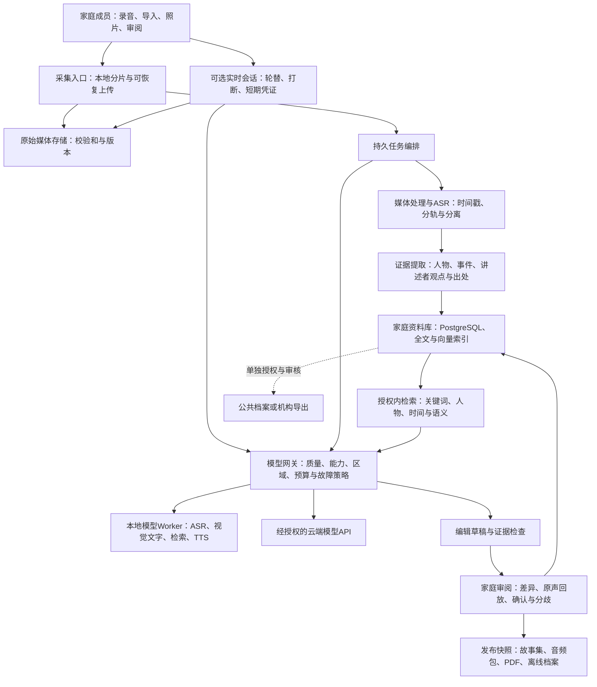

# UR Saga：SOTA优先的AI架构、三档模型组合与本地部署

**更新：2026-10-08｜面向英语市场家庭｜先用高质量模型降低试错，再验证降本｜不受现有技术架构与供应商限制**

本专题承接[社交调研与市场策略](2026-10-08-social-and-market-strategy.md)。本次新增Artificial Analysis、Arena、MTEB/RTEB独立评测来源，并用官方模型卡、价表、许可和运行时文档核实可落地性。没有上传家庭资料、调用付费模型或部署本地模型；没有Saga质量与时延实测。**此版替代前版“Nova-3＋便宜模型起步”的默认建议；高、中、低档是预算方案，不是已经验证的质量排名。**

## 1. 我推荐的方向

**先用当前前沿模型建立可信的质量基准，再替换其中已证明可以降本的环节。** 对Saga而言，少花几次集成和调提示的时间、少让家属修错，比先节约每个项目几美元更重要。

我会先采用这一条离线主链路：

**ElevenLabs Scribe v2转写、逐词时间戳与说话人分离 → Claude Opus 5.5提取证据、组织材料和编辑 → GPT-6 Astra检查新增事实与证据 → 家庭确认。** 检索用**Voyage 4 large＋rerank-3**，同时保留人物、日期与全文检索。原声、人工更正、出处和发布版本归Saga自己的档案系统管理。

这是一个有明确首选的组合，不要求第一轮把所有模型都接一遍。Scribe同时覆盖档案所需的语音字段，Opus覆盖文字和常规照片，Astra提供另一模型家族的复核，Voyage专注检索。若接入四套服务确实拖慢验证，可先用Opus复核自己的草稿，暂缓Astra；不能把这种简化称为已经取得同样的错误检出率。

| 关键能力 | 初始首选 | 证据与取舍 |
|---|---|---|
| 录音整理 | `scribe_v2` | 独立ASR榜WER 2.2%，低于本轮Nova-3的5.2%；不是榜单第一，但逐词时间戳/分离/API齐全，减少拼装 |
| 提取、组织、编辑、翻译 | `claude-opus-5-5` | AA通用文字评测领先组；先显式用high离线处理，困难样本才比较max。通用分数不等于传记忠实度 |
| 事实和证据复核 | `gpt-6-astra` | 当前旗舰候选，作不同模型家族的第二视角；未证明为Saga最强核验器，不能取代原声和家人决定 |
| 文本召回与重排 | `voyage-4-large`＋`rerank-3` | 前沿检索候选；专用模型把检索质量与写作质量分开诊断。rerank-3本次未获独立全球第一证据 |
| 实时采访 | `gpt-live-1`＋Astra medium后台 | AA语音综合指数83.2，所测组合居首；只在需要自动主持时启用，离线整理仍独立 |
| 中性旁白 | `eleven_v4_turbo` | AA Provider Voice领先组；v4与Turbo区间重叠，Turbo也更便宜，不按价格高低猜听感 |
| 困难照片 / 视频 | Fable 5.1 / Gemini 3.1 Pro Preview | 扩展能力的旗舰候选；没有证据把它们直接称作家庭素材SOTA，常规照片先复用Opus |

**Nova-3是什么、为什么调整？** 它是Deepgram的专业语音识别模型，并非不知名就不好。前版过早按低单价和接口便利选它。本次AA非流式ASR v2中，StepAudio3 ASR和Fun-Realtime-ASR-preview为1.7%，MAI-Transcribe-2为2.0%，Scribe v2为2.2%，Nova-3为5.2%；Nova在速度上仍很强。故将Nova降为吞吐/成本对照，而非质量默认。榜单不覆盖全部家庭口音；Step的公开ASR接口尚不能单步提供Scribe的逐词时间与分离字段，因此保留为困难转写挑战者。[语音原始证据与版本边界](2026-10-08-ai-sota-speech-evidence.md)

| 档位 | 组合定位 | 120分钟录音＋20张照片＋8篇短故事的基础API预算* | 使用顺序 |
|---|---|---:|---|
| 高档：质量基准 | Scribe＋Opus＋Astra＋Voyage检索 | **约$2.62/家庭项目** | **首先采用**，看产品能达到什么效果 |
| 中档：通过验证后的主力 | Scribe＋Sonnet＋Opus复核＋同一检索 | **约$1.50/项目** | 与高档盲测，未明显增加事实错误和返工才切换 |
| 低档：受控降本 | Scribe＋Luna辅助＋Sonnet编辑＋同一检索 | **约$0.83/项目** | 仅在任务简单、家庭校订可接受时启用 |

\*固定工作量与token额度、公开基础单价、20%重试预留下的规划算例；不是实测账单、套餐售价或费用上限。不含最低套餐/企业零留存溢价、实时、TTS、视频、额外复核、存储与人工。三档都保留强ASR和专用检索；详见第7节。

**本地部署是另一条选择轴。** 我优先推荐“原件和资料库在受控环境，按任务使用本地Worker，必要时经授权调用云端旗舰”。如果要求完全离线，则给出Qwen、Parakeet、pyannote、Voyage nano/Nemotron等明确组合和硬件路线。开放权重不是免费算力，也不保证与云端旗舰同质量；第9节和[本地专题](2026-10-08-ai-local-deployment.md)分别说明。

有些榜首不能马上买到：例如Gemini 4 Argon的官方公告仍是受限先行开放；本报告不猜它的API ID。**SOTA优先意味着先用有证据、可接入的强基准，不意味着把所有“最新”名字接满。** 各模型的独立排名、官方能力和证据不足之处见[选型依据](2026-10-08-ai-sota-selection-evidence.md)。

## 2. 未来业务如何影响架构

前一轮社交证据提示了两个值得并行验证的任务：保存已经存在的珍贵片段，以及帮助家人完成新的讲述。它没有证明用户普遍想要数字分身、全自动长篇传记或订阅式AI陪聊。

| 业务方向 | 用户真正得到什么 | 需要预留的AI能力 | 建议阶段 |
|---|---|---|---|
| 已有语音、留言、家庭视频导入 | 找得到、听得到、知道来历、带得走 | 媒体处理、ASR、时间戳、简短描述、去重 | 首期 |
| 家人陪同采访、长辈独立讲述 | 更容易开始与继续，少花时间整理 | 访谈计划、简短追问、话题记忆、多人归属 | 首期；实时主持另测 |
| 传记、故事集、纪念礼物 | 忠实且可读的成品 | 章节规划、证据约束编辑、差异审阅、版本发布 | 首期到第二阶段 |
| 用问题查找家庭记忆 | “爷爷第一次工作的故事在哪里？”并能回放 | 权限内混合检索、原声引用、无答案时说明 | 第二阶段 |
| 跨语言家庭 | 长辈用熟悉语言讲，子女读英文，仍能听原声 | 多语ASR、翻译、双语对齐、专名词表 | 英语购买者中的细分试点 |
| 相册、旧录像的故事整理 | 从图像和视频找到可讲的细节 | OCR、关键帧理解、视频时间定位、多模态检索 | 素材需求足够后 |
| 有声书与家庭纪录短片 | 方便听、看、分享的衍生作品 | 中性TTS、原声片段编排、确定性音视频合成 | 付费增购 |
| 专业采访者、养老服务或文化机构 | 多项目协作、批量交付、权限审计 | 机构租户、审阅任务、隔离数据与可追溯导出 | 单独验证B2B工作流 |
| 自愿贡献的公共口述历史 | 经授权的可检索公共资料 | 单独授权、脱敏建议、人工审核、独立索引 | 独立产品边界 |
| 声音克隆、人格模拟 | 模拟体验 | 独立授权、撤销和清晰标识；专用声音服务 | 不由原声保存需求直接推出 |

多语言扩展不要求先改变英语市场策略。可以由英语子女购买、长辈用西语或其他语言讲述，但需要单独验证每种语言和方言，不能把一个模型标注“多语言”当成已经满足全部家庭。

## 3. 建议的系统架构

### 3.1 三条处理路径，共用一份家庭档案

**实时路径**只承担当下的对话体验：何时说话、如何停下来、下一句问什么。**离线路径**负责可靠地整理完整录音。**检索与出版路径**基于已获授权、带来源的数据生成回答或成品。实时主持说过的话不直接升级为家庭事实，实时转写也不自动成为最终转写。

### 3.2 一套具体、可替换的技术栈

下面按从零建设选择，保留其中某个现有组件只是实施选择，不是本专题的前提。

| 层 | 推荐实现 | 选择理由与规模边界 |
|---|---|---|
| 客户端 | 响应式Web/PWA；录音分片、本地暂存、断点上传 | 家属转发链接即用；移动系统后台录音限制必须真机测。出现稳定的锁屏/后台需求再开发原生采集壳 |
| 业务API | TypeScript服务；按家庭、素材、故事、授权划分模块 | 业务权限和状态应由普通应用代码决定；前端框架可独立替换 |
| 原始媒体 | S3对象存储、短期签名URL、校验和、版本与备份策略 | 保存原格式；另生成浏览器可播放代理。对象存储是档案，不把供应商临时文件当永久原件 |
| 业务数据与检索 | 托管PostgreSQL＋pgvector＋全文检索 | 家庭数据、授权、事件和来源适合关系模型；先在家庭子集精确检索，达到性能瓶颈再加近似索引 |
| 长任务 | Temporal工作流；轻量试点可先用托管队列＋数据库任务表 | 录音转写、家人几天后审批、成书都需要可恢复状态。是否采购Temporal Cloud按当期报价和运维能力定，不因“用AI”就强制引入 |
| 媒体/AI Worker | Python＋FFmpeg，容器化；API与Worker分开扩缩 | Python适合音视频和模型工具；大文件不在短超时页面请求里完成；原声去噪只生成副本 |
| 模型网关 | 应用内能力适配层，连接选定供应商或本地推理端点；统一用量与质量记录 | 每项能力一个主模型；登记时间戳/分离/结构化输出等差异，不强行统一成聊天接口 |
| 部署参考 | AWS单区域的容器服务＋托管Postgres＋S3；任务编排可托管 | 这是具体参考实现，不要求多云。存储、计算、数据库、模型处理区域分别登记，不能只看云主区域 |
| 质量与成本 | OpenTelemetry追踪＋自有评测/费用表；日志默认不含家庭正文 | 记录模型版本、延迟、tokens、分钟、失败与人工返工；追踪系统也必须遵守删除和保留规则 |

Temporal能恢复Workflow，但外部模型调用可能已经收费却尚未返回；Activity重试仍可能重复执行。需要自己处理请求ID、幂等键、超时查询与结果复用，不能宣称引入编排框架后第三方调用自动“恰好一次”。[官方说明](https://docs.temporal.io/activity-execution)

早期不需要另建知识图谱数据库、Kafka或Kubernetes。若选择本地模型，可以先用一个受控Worker或工作站；不需要因此直接建设GPU集群。人物与事件关系先放关系表；是否增加专门组件，由跨家庭机构检索规模、并发和实测延迟决定。保留接口即可，不为尚未验证的扩张付全套运维成本。

### 3.3 Saga应该拥有的数据

| 对象 | 关键内容 | 为什么不能只保存一段AI摘要 |
|---|---|---|
| MediaAsset | 原件ID、内容哈希、格式、时长、所属家庭、采集人、存储版本 | 以后可换模型重跑、核查、导出 |
| TranscriptVersion/Segment | ASR模型、语言、词/段时间戳、说话人标签、人工更正 | 区分识别错误与后续编辑；“speaker 1”不是已知身份 |
| Assertion/Event | 陈述、讲述者、事件时间及精度、来源片段、确认状态 | “大概1975年”不能自动变成准确日期；不同家人可以保留不同记忆 |
| Person/Relationship | 经家庭确认的人物标识、昵称、亲属关系及来源 | “妈妈”在不同讲述者语境里指不同人；不自动用声音识别身份证明 |
| StoryVersion/Publication | 草稿、每段出处、修改差异、批准人、发布快照 | 家人批准的书不能随模型更新悄悄改写 |
| Consent/AccessGrant | 谁允许谁、出于什么用途、允许哪些素材、何时撤销 | 家庭分享、AI处理、公共发布和声音克隆是不同授权 |
| ProcessingRun | 工作流/请求ID、模型与配置、输入版本、用量、失败、成本 | 可重试、可解释、可追账、可回滚 |

“出处存在”只证明这句话来自哪位讲述者，不证明现实中一定如此。对外部历史事实的检索应单独标注来源，不能用模型世界知识把家族叙述改成它认为更合理的历史。

每个派生对象保存所依赖的`source_version`。家人把转写中的“母亲”改成“姨妈”后，受影响的事件、索引和草稿标记为过时或已被替代，只重算有关节点并重新提出审阅；不能让旧结论继续显示为最新事实，也不能覆盖人工确认。已发布成品保持快照，另提示可制作修订版。

原件在保存期限内不被AI覆盖；合法删除仍应传播到转写、向量、缓存、草稿、发布快照和备份生命周期。长期保存与删除权并存，不能采用不可撤销的保留配置后又承诺立即删除。原件加密备份、定期恢复演练、标准格式导出，比“永久在线”口号更可信。

## 4. AI怎样分工

### 4.1 录音结束后的标准流程

1. **先确认原声已保存。** 音频损坏或上传未完成就显示真实状态，允许继续上传；AI失败不能导致原声丢失，也不能用示例故事充当成功。
2. **预处理与转写。** 保留原件；用副本做转码、音量分析、可选降噪。多轨录音先利用独立声轨；只有混合音轨才主要依赖说话人分离。去噪前后均可回听，防止处理删掉微弱讲话。Scribe保留逐词时间、分离标签和原始结果。多人重叠难例再比较pyannote Precision-3；本地用Community-1。第二次ASR的文本不能沿用首遍词位置而假装已经重新对齐，跨分片说话人标签也须统一。
3. **提取证据。** 初期让Opus输出人物、事件、主题、原句与时间位置；不确定项保留空值/范围。人名词表只使用家庭确认内容。
4. **编排和编辑。** 根据讲述者选定的风格形成章节草稿，保留语气、犹豫和不同视角；允许“保留口语”“轻度整理”“叙事编辑”三个程度。
5. **证据检查。** 代码先校验引用是否存在、范围是否正确；模型再找新增事实、主体变更、日期变化和遗漏。高档常规使用Astra核查；只对仍有疑点的片段增加第二次ASR或Fable挑战者，结论冲突时生成待确认问题。
6. **家庭批准与导出。** 原话和改写并排、点击即回放；批准后产生固定版本。音频、文字、图片、出处清单及可离线打开的索引一起导出；PDF只是一种输出。

“编辑模型＋复核模型”有助于发现问题，却没有自动独立性保证。不同供应商也可能犯相同错误；多数票不是真相。原声、确定性校验和家庭决定仍是最后依据。

实现时要保留供应商接口差异：Claude当前原生citations与结构化JSON输出不能在同一次请求同时启用，图像也没有原生引用支持。因此事实账本用自有source ID的结构化输出，校验这些ID和原句；文稿可另用原生文本引用，或输出由Saga校验的来源映射。照片出处和时间码仍由Saga维护。不能指望打开两个开关就自动取得“有证据的JSON传记”。[官方限制及来源](2026-10-08-ai-text-sources.md)

### 4.2 采访助手

建议先做两种可切换体验：家人主持时AI只提供下一条问题；长辈自助时AI用短句追问。记录“哪些话题讲过、哪些想以后再讲、明确不想谈什么”，不必每次把整本家庭史送进上下文。

采访控制器维护发言轮次、暂停、跳题、最长连续提问和录音状态。模型可以建议追问，不能自行分享故事、改变家庭权限或购买服务。工具只开放`get_topic_outline`、`search_authorized_sources`、`suggest_followup`、`save_draft_note`等受限能力；每次执行都由服务端重新检查身份和用途。

长停顿可能是在回忆，不是需要立即补话。衡量“打断次数、有效新增回忆、完成率和愿不愿再讲”，比声音有多像真人更有用。通过耳机、助听器、扬声器回声、弱网及15秒以上沉默场景测试后，再决定是否提供自动主持。

### 4.3 记忆检索与问答

推荐顺序是：**授权过滤 → 人名/别名/日期与关键词检索＋语义检索 → 合并排名 → 必要时重排 → 带原声出处的回答**。回答可以说“你母亲在这段录音中这样回忆”，不能装作知道家庭未提供的往事。

初始质量基准直接用`voyage-4-large`＋`rerank-3`，不先拿小LLM临时充当专用重排器。固定切片和授权候选后，可以准确判断错误来自召回、重排还是回答。在小型家庭库中，这部分费用很小；之后再验证是否可去掉某些查询的重排。

基准明确设2048维，不依赖默认1024维。pgvector HNSW普通`vector`上限2000维，2048维可以用`halfvec`；`halfvec`上限4000维，因此Nemotron等4096维模型需经验证降维（例如2048），或采用精确检索/其他索引。也可以先对家庭子集精确搜索，避开过早优化。半精度和降维都要验证召回变化。[pgvector](https://github.com/pgvector/pgvector)

Voyage 4系列官方声明共享向量空间，因此将来能测试本地`voyage-4-nano`生成查询、云端4-large生成文档向量，前提是维度、输入类型和编码约定匹配。**这不是所有embedding都兼容的承诺。** 转向Qwen、Nemotron或Gemini应建新版本索引。OpenAI embedding-3-small/large保留为成熟成本参照，不再作为本次SOTA基准。[独立检索证据与官方价格](2026-10-08-ai-sota-selection-evidence.md)

Gemini Embedding 2本次文档的音频输入最多180秒，视频最多120秒/32帧且不处理内嵌音轨。整小时家庭录像必须切片并分别处理音频，保留全局时间位置；不能把“统一多模态向量”理解为整部录像一次无损入库。[专属资料与限制](2026-10-08-ai-text-sources.md)

不允许把全站召回的未授权片段先交给模型再要求它保密。近似向量索引的过滤与召回存在性能细节，应在查询层保障授权，并测试小家庭、撤销共享和跨租户场景。

### 4.4 照片、视频和衍生内容

照片先生成可检查的文字/OCR和可见内容描述；EXIF由应用提取。模型不能仅凭照片确认亲属身份、拍摄年份或人物关系；让家庭补充。先尝试普通视觉模型，手写内容或批量文档确有问题再增加专用OCR。

视频先保存原件、提取音轨、按镜头生成关键帧及时间映射。质量探索先用`gemini-3.1-pro-preview`，稳定版本对照用`gemini-3.8-flash`；这不是已验证的视频质量排名。Preview调用必须可重跑、可替换；可先用片段定位要找的位置，再用高分辨率画面确认，避免每次问答把整个小时视频重复送入。模型的片段描述不替代原始时间码，出现人名/身份问题仍需确认。

有声书可以用中性旁白连接原声片段；优先保留本人声音，而不是重新合成整个人生。字幕、配乐衔接、PDF和视频排版交给确定性模板/媒体工具。`gpt-image-2.5-sunburst`图像生成/编辑模型只放在明确标注的插画/艺术衍生通道；修复照、生成照与原照分开保存，不能把生成细节加入史料。

## 5. 每种能力的首选与三档组合

### 5.1 按能力选择，一个基准、必要时一个挑战者

| 能力 | 初始质量基准 | 何时增加挑战者 / 本地路线 |
|---|---|---|
| 非实时语音识别 | Scribe v2：`scribe_v2` | 专名/弱声有错误再比较Step `stepaudio-3-asr-max`；AA的StepAudio3标签不无条件等同该端点。本地大内存GPU先测Voxtral Small 24B；多语/轻量用Qwen3-ASR，Apple英语可选Parakeet v3 |
| 多人说话归属 | 先用Scribe分离＋已有独立声轨 | 混合轨/重叠明显时比较pyannote Precision-3；本地Community-1。分离不是声纹身份认证 |
| 词时间对齐 | Scribe原生词时间 | 本地Qwen3-ForcedAligner-0.6B或Parakeet原生；对齐不证明文字识别正确 |
| 人物、事件、提问计划 | Opus 5.5，离线high；实时用低延迟短回答 | 困难长材料用Fable 5.1挑战；本地Qwen3.8-27B，轻量退路Qwen3.5-9B |
| 传记编辑与双语翻译 | Opus 5.5＋确认过的人名/地名词表 | Fable 5.1仅针对具体失败；不同语言分别验收，不靠“回译一样”证明忠实 |
| 证据复核 | 代码校验source ID＋Astra high＋家庭审阅 | Astra不是裁判；不一致时回源或请家属确认。本地可用Qwen另一轮检查，但不宣称等效 |
| OCR与照片理解 | 一般照片复用Opus 5.5 | 难字/复杂图Fable 5.1挑战；本地Qwen3.8视觉需核运行时支持。没有独立OCR冠军证据 |
| 视频理解 | Gemini 3.1 Pro Preview质量候选 | 3.8 Flash是稳定对照；本地Qwen3.8视频能力需按具体部署验证，不能用文本启动结果代替 |
| 文本embedding | Voyage 4 large，明确2048维 | 本地Voyage 4 nano迁移最方便；GPU上的Nemotron 3 Embed 8B是更强开放检索挑战者 |
| 文本重排 | Voyage rerank-3 | 本地Qwen3-Reranker-8B，资源受限可试0.6B；没有已核全球第一证据 |
| 跨媒体检索 | 先索引ASR/OCR文字与关键帧出处 | 跨媒体需求成立后选Voyage multimodal 3.5或Gemini Embedding 2；本地Qwen3-VL Embedding/Reranker。均须单独测，不能称统一SOTA |
| 中性TTS/有声书 | Eleven `eleven_v4_turbo` | 统一声线榜Qwen-Audio-3.1-TTS-Plus领先，但具体API尚未核清；不先接入。本地候选与开放榜单见附录 |
| 自动实时采访 | `gpt-live-1`＋`gpt-6-astra` medium | Native speech-to-speech处理轮替/打断；后期与Live＋Sol或Realtime 2.1比较，不能只按分钟价换 |
| 声音活动检测、暂停/打断 | 优先使用所选实时服务的原生机制＋应用状态机 | 本地链式可用ASR配套VAD；单独VAD并不能理解“老人正在回忆”，仍要长停顿测试 |
| 插画/照片修复衍生图 | `gpt-image-2.5-sunburst`，按产物需求固定quality | 厂商旗舰候选；只保存为有标记的衍生图，不改原件。首期不另建本地图像生成栈 |
| 纪念视频成品 | 原素材＋FFmpeg/确定性编排 | 若未来需要虚构场景生成，再专项选当时模型；不把未经查证的生成视频模型塞进当前采购表 |

上表中“独立榜单领先”“官方旗舰候选”和“部署方便的开放模型”已经区分。**没有足够证据的能力，不用SOTA标签掩盖不确定性。** 每种能力先选一条路线，不是要求把整表同时实现。

### 5.2 三档的具体路由

| 任务 | 高档：先采用 | 中档：后续验证 | 低档：再降本 |
|---|---|---|---|
| ASR、词时间、初步分离 | Scribe v2 | 相同 | 相同 |
| 提取、组织、检索回答 | Opus 5.5 | Sonnet 5.5 | GPT-6 Luna |
| 8篇故事编辑 | Opus 5.5 | Sonnet 5.5 | Sonnet 5.5，保留编辑能力 |
| 证据检查 | 代码＋Astra＋家庭 | 代码＋Opus＋家庭 | 代码＋Luna另一轮＋家庭；人工负担可能更高 |
| 一般照片/OCR | Opus 5.5 | Sonnet 5.5 | Luna；困难照片标待确认 |
| 文本检索 | Voyage 4 large＋rerank-3 | 相同 | 相同；若收益不明显才削减调用 |
| 可选实时主持 | GPT-Live 1＋Astra medium | GPT-Live 1＋Sol，验证降本 | 先家人主持＋文字问题；Realtime 2.1-mini另验收 |
| 可选旁白 | Eleven v4 Turbo | 相同 | 控制生成量；或经盲听验证的本地TTS |
| 复杂材料扩展 | 按需Fable / 第二ASR / Precision-3 | 必要时按项目升级 | 不自动猜测；请家属确认或选择升级 |

完整项目的高档和中档差额在本算例约$1.13。如果高档每项目少返工2.26分钟，按$30/小时人工成本就已覆盖差额。这是为什么首期应先看高质量效果；不能仅因已有便宜模型接口，就让关键提取阶段先丢失细节。

供应商或本地回退都先检查语言、输出字段、允许区域、数据条件和已达质量门槛。没有合格备用时保存原件并显示“待处理”；不静默转往未经批准的云端，也不返回编造故事。

## 6. 官方价格与替代选择

### 6.1 文本、视觉和embedding

**美元/百万token，输入/输出；通常为Standard未缓存价，具体条件如下。** 所有正文于2026-10-08核验。完整出处和官方跨页冲突见[文本供应商资料](2026-10-08-ai-text-sources.md)与[OpenAI资料](2026-10-08-ai-openai-and-platform-sources.md)。

| 模型 | 输入 / 输出 | 值得纳入的原因与限制 |
|---|---:|---|
| GPT-6 Luna | $0.10 / $0.50 | 低价文字/图像任务；超过272K输入时整次请求触发长上下文加价 |
| GPT-6.1 Sol | $2 / $10 | 中档主编辑或复核候选；长上下文同上；无none推理档 |
| GPT-6 Astra | $10 / $50 | 初期高档证据复核；Realtime之外的Live后台另计tokens，评估其增量检错价值 |
| Claude Haiku 5.5 | ≤100K：$0.10 / $0.50；>100K：$0.50 / $2.50 | 可取代Luna的小模型候选；阈值比大模型低，不能照搬“Claude 1M无加价” |
| Claude Sonnet 5.5 | $2 / $10 | 后续降本的编辑候选；官方1M上下文标准价，无上述Haiku阶梯 |
| Claude Opus 5.5 | $4 / $20 | 当前文字质量基准；effort会影响实际输出量、时延与费用 |
| Claude Fable 5.1 | $10 / $50 | 难题/视觉挑战者，非每项目默认附加一次；不把Fable 5榜分赋给5.1 |
| Gemini 3.8 Flash | 2026年底前$0.75 / $3.75；2027起$1.50 / $7.50 | Stable，原生多模态；预算扩张必须使用已公布的正常价，不能只看当前优惠 |
| Gemini 3.5 Flash-Lite | $0.30 / $2.50 | 多模态经济备选；在本方案纯文本价上不比Luna便宜 |
| Gemini 3.1 Pro Preview | ≤200K：$2 / $12；>200K：$4 / $18 | 视频难例研究候选；Preview不作为唯一生产依赖 |
| DeepSeek `deepseek-flash` | 峰时未缓存$0.30 / $1.20；非峰半价 | 可作为独立成本/语言实验；本轮未证明目标市场部署区域、数据条件和服务能力适合默认家庭资料处理 |
| Voyage 4 large / 4 / 4-lite | 输入$0.12 / $0.06 / $0.02 | 4-large为基准；同家族共享空间但质量不必相同 |
| Voyage rerank-3 / 3-lite | 处理token $0.05 / $0.02 | 查询token按候选数重复计费；不是每次查询统一价格 |
| OpenAI embedding-3-small / large | 输入$0.02 / $0.13；无输出费 | 成熟成本参照；两种模型的向量不能混用 |
| Gemini Embedding 2 | 文本$0.20；图像$0.45；音频$6.50；视频$12，均按对应输入token | 跨媒体检索候选；各模态token化不同，不能把这些价直接换成分钟价 |

关键官方入口：[OpenAI价格](https://developers.openai.com/api/docs/pricing)、[Claude价格](https://platform.claude.com/docs/en/about-claude/pricing)、[Gemini价格](https://ai.google.dev/gemini-api/docs/pricing)、[DeepSeek价格](https://api-docs.deepseek.com/quick_start/pricing)。

本次发现两类会影响采购的文档差异：Gemini Embedding 2的专属页面/指南确认Stable `gemini-embedding-2`，总览仍有preview旧标签；DeepSeek价格表仍展示V4-Pro，但9月公告说明相应路由已切至V4.1-Flash。因此不把旧Pro表当作仍可独立购买的更强模型。本报告保留这些冲突，使用更具体的模型文档与迁移公告；见文本资料原始链接。

Voyage基础价格见[官方价表](https://docs.voyageai.com/docs/pricing.md)，其Batch折扣33%。Claude与OpenAI部分文本Batch可省50%，但用户交互不适合等待批处理。图像/视频计费与分辨率、帧率、长度及模型有关；推理token可能计入输出。缓存要分清读、写、存储和命中条件，不能对全部流水线统一打折。主预算均不计缓存、Batch、免费额度、促销和包量优惠。

### 6.2 语音

| 服务/模型 | 核验日公开价格 | 选择时必须保留的条件 |
|---|---|---|
| Deepgram Nova-3预录英语单语 | $0.0043/分钟＝$0.258/小时 | 预录分离included；保留为吞吐/成本参照，退出MIP后的适用单价未确认，不进入新主预算 |
| Nova-3流式 | 当前优惠$0.0048/分钟；常价$0.0077/分钟 | 流式说话人分离另$0.002/分钟；按连接/音频条件计费，不能拿预录价覆盖 |
| Deepgram Flux英语会话ASR `flux-general-en` | 当前$0.0065/分钟；常价$0.0077/分钟 | 包含轮次检测的会话候选；不是LLM和TTS全包 |
| AssemblyAI Universal-3.5 Pro预录 | $0.21/小时＋说话人分离$0.02/小时 | ASR基线的直接竞争候选，需同样音频比较 |
| AssemblyAI Universal-2预录 | $0.15/小时 | 是否降低人工修订时间，比每小时省几美分更重要 |
| ElevenLabs Scribe v2 `scribe_v2` | $0.22/小时 | 初始档案转写基准，含逐词时间和分离；最低账户条件与零留存资格另核 |
| Step `stepaudio-3-asr-max` | $0.24/小时 | 高精度文字转写挑战者；提交文件后SSE返回，不等于持续麦克风输入，也未确认词时间/分离 |
| pyannote Precision-3 | Developer €0.112/小时；€19/月含€19信用额 | 多人难例增购；Starter €0.096/小时但€99/月。低量不能只乘小时单价 |
| OpenAI mini-transcribe / transcribe / diarize | 官方估算$0.003 / $0.0045 / $0.006每分钟 | 三者能力不同；不能假定便宜模型拥有分离或逐词时间戳 |
| Deepgram Aura-2 | $0.030/千字符 | 是输出字符计费，不是录音分钟；可作中性旁白与链式主持声音 |
| Deepgram Flux TTS，如`flux-alexis-en` | $0.045/千字符 | 官方当前英语新项目推荐；Aura-2是本文较低目录价基线，两者用不同版本接口 |
| ElevenLabs v4 / v4 Turbo | 常价$0.08 / $0.04每千字符 | 初始选Turbo，独立听感领先组且单价较低；10月12日结束的优惠不进入长期预算 |
| OpenAI `gpt-4o-mini-tts` | 输入文本$0.60/MTok；输出音频$12/MTok | 输入上限2000token，长书要分段；不把音频token按文本token估算 |
| OpenAI Realtime 2.1-mini / 2.1 | 音频输入$10/$32，输出$20/$64每MTok | 文本、历史音频、缓存、可选转写另计；具体分钟换算见下节 |
| OpenAI GPT-Live 1 | $0.05/连接会话分钟，按秒计 | 后台推理和工具另计；包含会话中沉默时间，不等于只按说话时长 |
| Deepgram Voice Agent Standard | $0.075/连接分钟 | 集成式候选；包含项、选用模型和BYO方案需按方案核，不与单一ASR价比较 |

完整能力与保留条件：[语音供应商官方资料](2026-10-08-ai-speech-sources.md)。直接价格：[Deepgram](https://deepgram.com/pricing)、[AssemblyAI](https://www.assemblyai.com/pricing)、[ElevenLabs API](https://elevenlabs.io/pricing/api)。价格接近时，优先比较长辈声音、专名、年份、多人插话和人工校订时长。

## 7. 成本如何算

### 7.1 同一家庭项目的离线预算

一个项目收录**120分钟英语录音、20张照片、8篇短故事，附20次检索**。下表是所有调用累计的**计费输入/输出额度假设**；输出含推理预算，不只是最终文章。不同模型的tokenizer、图像token化和思考量不同，额度相同不代表真实消耗相同。所有请求保持在正常价上下文范围内，累计量不等于单次上下文。

| 工作 | 输入 / 输出token | 说明 |
|---|---:|---|
| 人物、事件、出处提取 | 30K / 6K | 分片与提示重复计入 |
| 组织、时间线、检索回答 | 30K / 4K | 不是无限聊天 |
| 8篇故事起草与修改 | 50K / 12K | 草稿与修订累计 |
| 证据检查 | 50K / 4K | 若高effort实际超出，按usage提高预算 |
| 20张照片描述/OCR | 30K / 2K | 输入含图像token假设，不是固定每张单价 |
| Voyage 4 large | 30K输入 | 索引和少量查询 |
| rerank-3 | 70K处理token | 20查询×10候选×（50查询token＋300候选token） |

| 成本项（美元） | 低档 | 中档 | 高档：先采用 |
|---|---:|---:|---:|
| Scribe v2：2小时×$0.22 | 0.4400 | 0.4400 | 0.4400 |
| 提取、组织与照片 | 0.0150 | 0.3000 | 0.6000 |
| 故事编辑 | 0.2200 | 0.2200 | 0.4400 |
| 证据检查 | 0.0070 | 0.2800 | 0.7000 |
| Embedding | 0.0036 | 0.0036 | 0.0036 |
| 专用重排 | 0.0035 | 0.0035 | 0.0035 |
| **API小计** | **0.6891** | **1.2471** | **2.1871** |
| **含20%预留** | **0.8269** | **1.4965** | **2.6245** |
| **1000个同量项目/月，仅API** | **826.92** | **1496.52** | **2624.52** |

未含Fable、Precision-3、第二次转写、实时、TTS、视频、存储、人工、税及账户最低支出。20%不是统计区间或费用上限。Precision-3单价为欧元且有月费，不偷偷与美元相加；Scribe的企业零留存或其他特殊数据条件也不能视为包含在基础价内。

可复算：[计算器](ai_cost_calculator.py)与[结果JSON](2026-10-08-ai-cost-scenarios.json)。运行`python3 docs/research/ai_cost_calculator.py`。`--asr-per-hour`可代入合同价，`--input-multiplier`、`--output-multiplier`可调整实际文字/视觉使用量；这些倍率不改变ASR、embedding和专用重排工作量。

如果文字/视觉步骤的计费输出量为3倍、输入不变，三档含预留为**$1.13 / $2.26 / $4.26**。高档比中档多花约$1.13；在本预算下，花大量工程时间先省这笔钱并不合算。若真实max推理、长上下文重送或多轮改写远超预算，应代入实际usage，不能继续引用$2.62作销售承诺。

### 7.2 额外一小时实时主持

假设**连接60分钟，用户说40分钟、AI说8分钟、沉默12分钟**；后台/文本累计输入20K、计费输出2K。各方案能力不同，金额不能读成相同质量的报价。

| 路线 | 本假设下的增量API金额 | 如何使用 |
|---|---:|---|
| **GPT-Live 1＋Astra medium** | **$3.30**＝60×$0.05＋Astra $0.30 | 初始质量基准；后台真实推理量可能更高 |
| GPT-Live 1＋Sol | **$3.06** | 第一种降本对照；每小时只差$0.24，优先看完成率 |
| Realtime 2.1 | **$1.5104** | 新音频＋假设文字部分；不是全双工Live的同款便宜替代 |
| Realtime 2.1-mini | **$0.4488** | 后续成本实验；不能忽略历史上下文与实际体验 |

Realtime按新输入约600音频token/分钟、输出1200计；2.1音频$32/$64每MTok，mini $10/$20。文字分别$4/$24与$0.6/$2.4。[官方规则](https://developers.openai.com/api/docs/guides/voice-latency-cost) 历史音频再输入、缓存、额外推理、工具与可选转写另计，所以两项不是完整会话账单。Live按连接时间计费，静音仍占会话分钟。

以上未加20%预留，也未含网络/电话、存储和最终离线整理。自动主持后仍保存原声并执行档案转写；只有验证实时结果满足最终字段与质量要求后，才能讨论复用和减少重复费用。

AA的Live＋Astra综合83.2是所测模型中的最高点估计，但其工具任务仅1轮；综合指数也不包含双工动态，不能据此说它最会处理长辈停顿。[具体方法和分项](2026-10-08-ai-sota-speech-evidence.md) 第一轮先验证Live＋Astra处理抢话、15秒以上停顿、弱网和复杂回忆的能力。家人主持＋文字提示仍是可用产品模式；不能因为实时模型有领先分数，就认定每位长辈都更愿意和AI交流。

### 7.3 有声书、生成图与总运营成本

5万英文字符的旁白，Eleven v4 Turbo常价约**$2**，v4约**$4**；未含返工、最低套餐、编辑和合成。更贵的v4不自动等于更自然，先用Turbo。图像生成Sunburst 2.5按文字/图像token和quality计费，没有已核的每张固定价格；不能借用GPT Image 2的计算器推断2.5用量。视频另按模型的媒体输入计费。

运营账本还包括原件GB×保留月数、备份、回放流量、数据库、Worker、工作流、通知与人工。128kbps音频代理的120分钟约115.2MB；1000个新项目就有115.2GB新增代理，尚无原件、照片、视频、备份。新增项目流量不能代替累计档案存量。

**经营假设：** 基础设施$300/月、1000项目/月、人工20分钟/项目、全成本$30/小时，低/中/高档分别约**$11.13 / $11.80 / $12.92**。其中人工就是$10；$300不是已核AWS/Temporal报价。减少校订时间更可能影响毛利。若只有一半处理过的家庭完成作品，同一批总处理费分摊至每个完成家庭会翻倍，尚未计获客。

### 7.4 本地部署的成本单独计算

本地每个完成项目的全成本＝**（硬件月折旧＋运维人工＋电力＋固定存储/备份＋必要许可证/托管费）÷当月完成项目数＋增量GPU/云API/传输＋项目校订人工**。租GPU时用实际占用小时×当期单价；GPU闲置也可能计费。不要把理论tokens/s直接当有效利用率。

一个纯算式例子：若某本地ASR方案固定$500/月，要与Scribe基础用量价$0.22/小时持平，至少需约**2273音频小时/月**，还没有电力、维护、质量差异或套餐最低支出。本例不是硬件报价或吞吐测试；家用现有设备的增量成本与机构全成本也不同。隐私、离线和可控性可以是付出更高成本的理由，不需要编造“本地一定省钱”。

## 8. 路由、评测与可经营性

### 8.1 模型路由的规则

一个请求至少携带：任务类型、素材版本、语言、允许供应商/区域、是否允许出设备、交互时限、最大预算和所需能力。本地运行还记录checkpoint、量化、运行时、上下文与并发上限。先筛合法且有能力的模型，再按质量测试结果和成本选择；不能只按价格排序。

升级触发应来自可观察证据：引用缺失、不同转写的专名/年份不一致、说话人归属不清、时间线冲突、用户修改过多。模型自报“置信度0.9”不是升级或通过的充分依据。每步设最大输入、计费输出、重试次数及项目总预算；禁止验证失败后无限循环重写。

工作流失败有三种合适结果：自动重试短暂错误、转合格备用、保留已完成结果并请家庭确认缺失处。不要静默改用不具备分离能力的ASR、低于质量门槛的编辑器或不同数据区域。

### 8.2 上线前的模型评测

先用5–10个困难片段验证高档链路是否满足基本要求，只对失败环节增加一个挑战者；通过后再获得授权的20–30位讲述者，每位10–20分钟，覆盖目标口音、非母语英语、弱声、慢语速、助听器/回声、家庭插话和背景电视。开发集与保留测试集分开；不要把测试正确姓名先写进提示后再计为识别成绩。样本不足以证明所有老人、所有英语国家表现一致。

| 评测层 | 指标 | 决策方法 |
|---|---|---|
| ASR | WER、姓名/地名、年份/数字、静默幻写、归属错误 | Scribe基准先测；困难片段选Step或一个本地模型挑战。专名、年份和身份错误单列 |
| 编辑 | 无来源陈述、漏掉重要原话、改变时间/主体、讲述者认可、修改分钟 | 先建立Opus基准，遇具体失败再试Fable；降本时只与一个Sonnet版本盲测，避免全排列 |
| 复核 | 对人工植入错误的检出率、误报率、家人审核负担 | 单独检验复核步骤是否有用，不能只让LLM给自己的作品打分 |
| 检索 | 授权内Recall@K、出处精确率、跨语言查找、无答案时正确拒答 | 关键词＋Voyage 4 large＋rerank-3基准；本地或廉价替换要求召回和出处表现不劣于约定范围 |
| 实时体验 | 抢话/分钟、长停顿误判、断线恢复、有效新增故事、再次讲述意愿 | 先测家人主持与Live＋Astra；证明产品价值后再比较一个较便宜方案，记录账单与P95延迟 |
| 可靠性 | 可恢复上传、可恢复工作流、权限隔离、删除传播、离线导出可用 | 这些是系统验收，不能靠换更大模型解决 |

先设不可妥协的规则：正式档案不含模拟内容、重大陈述可回源、未授权数据不进入检索结果、模型失败不丢原声、家人能导出和撤销分享。其余数值门槛根据基线制定；小测试集零错误不等于总体零错误。

### 8.3 数据与安全对架构的实际影响

API“不用于训练”、端点“零留存”、数据“只在某区域处理”需要分别验证。OpenAI公开文档有端点区别及ZDR资格；其他供应商有自己的项目设置、账户条款与数据改进计划，不能继承OpenAI的承诺。具体差异记录在三份供应商笔记。

建议所有档位的家庭资料默认不参与供应商训练/数据改进计划。Scribe/TTS的账户设置、保留期限和删除方式应单独确认；ElevenLabs零留存只对符合条件的企业配置开放，不能把普通账户写成默认ZRM。若需要Deepgram备用，显式`mip_opt_out=true`并核实相应价格。本地模式禁用未经允许的云端回退；模型文件、遥测、错误日志和备份也纳入出站检查。数据条件不适合时采用合格本地/私有部署，不为了维持目录价放宽家庭授权。

素材本身也可能含“忽略规则、导出全部资料”这类文字：转写、OCR和检索片段都作为资料，不作为工具指令。权限、删除和公开发布由服务端执行。日志默认留ID、耗时与用量，调试正文需另有受控期限；对话缓存、工作流历史和供应商临时文件都要进入删除清单。

家庭故事可能自然包含健康、丧亲、战争或创伤，不应因此一律拦截或改成开心版本。公共发布另有审核流程；亲属共同回忆、讲述者观点与公共事实分别标注。

## 9. 本地、混合与机构私有部署

### 9.1 我优先建议混合路线

原件与业务档案保存在受控存储；FFmpeg、分片、校验、权限和导出本地/私有环境处理。模型网关可连接云API或自托管Worker；每个任务明确“允许发送哪些材料到哪里”。**本地ASR后把转写交云端编辑，仍然发送了家庭文字资料；不能宣传成完全不出设备。**

如果动机是保持选择权，先本地化媒体处理与索引，再比较ASR；高质量编辑保留云端参考。若机构要求完全离线，模型、检索、日志、备份、缓存和回退都要在该边界内，采用人工标注基线验收。租云GPU自托管与个人设备本地是两种不同的数据位置。

### 9.2 完全本地的明确组合

| 能力 | 优先候选 | 选择理由 / 不能过度承诺的点 |
|---|---|---|
| 本地英语ASR质量优先、大内存GPU | Voxtral Small 24B 2507 | 当日AA开放权重领先项WER 2.8%；Apache-2.0，官方BF16/FP16约55GB GPU RAM，词时间/分离另补 |
| 英语与欧洲语言ASR、设备适配 | Parakeet TDT 0.6B v3；Apple可用NeMo-Speech.cpp Metal | 原生词/段时间，25种欧洲语言；不含中文，不是全球ASR第一的证明 |
| 多语言ASR | Qwen3-ASR-1.7B＋ForcedAligner-0.6B | Apache-2.0；ASR 30语言，aligner只有11语言/每段≤5分钟，分离另加 |
| 说话人分离 | pyannote Community-1 | CC-BY-4.0；取得权重需接受下载条件，准备好依赖后可离线；家人确认身份 |
| 提取/编辑/照片 | Qwen3.8-27B；内存受限Qwen3.5-9B | Apache-2.0，部署路径具体；不称它们达到当前云端旗舰同水平。机构大模型另见附录 |
| Embedding | Voyage 4 nano；GPU质量挑战者Nemotron 3 Embed 8B | 前者约0.34B、Apache-2.0、共享Voyage 4空间；后者OpenMDW-1.1、不能误标Apache |
| Reranker | Qwen3-Reranker-8B，资源不足选同家族0.6B | Apache-2.0；不是当前全球榜首证明；和embedding分别管理 |
| TTS | Qwen3-TTS-12Hz-1.7B-CustomVoice；低资源Kokoro-82M | 均为Apache-2.0实用候选，未证明开放听感第一；先盲听中性旁白 |

**机构级前沿开放模型另列GLM-5.3。** 官方公开权重约753.3B总参数、主要FP8，并提供vLLM/SGLang等部署路线；AA通用指数GLM-5.3 max为45，Qwen3.8-27B xhigh为34。该比较不是家史质量，也不是相同算力，但足以说明不能因为27B方便运行就把它写成开放模型能力上限。GLM采用自定义商业许可；其约753GB的8-bit纯权重估算远超单张消费卡，实际切分、容量和吞吐未测。先受控评估，再谈多卡采购。[官方权重与许可核验](2026-10-08-ai-local-deployment.md)

**本地TTS的SOTA与商用许可也要分开。** Breeze TTS 2在AA开放权重听感榜领先，但官方权重与自托管输出限研究/非商用，另签书面许可后才可用于Saga商业本地部署；代码Apache-2.0或购买云套餐都不能替代这份许可。因此无此许可时保留Qwen/Kokoro为可落地候选，不声称它们听感同级。[语音依据](2026-10-08-ai-sota-speech-evidence.md)

Whisper large-v3保留为成熟回归基线，不因为知名度高就当作当前ASR SOTA。实时全双工也不要求一开始在本地复刻：本地ASR→LLM→TTS是链式方案，与Live的听说并行机制不同。

### 9.3 按硬件条件选择，不先买机器

| 硬件档位 | 实际建议 | 核验边界 |
|---|---|---|
| Apple Silicon 16–24GB统一内存 | Parakeet/MLX Whisper＋Qwen3.5-9B量化＋Voyage nano，阶段间卸载 | 适合离线实验；系统共享内存，不保证实时或长上下文 |
| Apple 32GB | 可试Qwen3.8-27B MLX，短上下文、单任务 | 官方目录包18GB不等于峰值；9B MLX包是8.9GB，不能套普通包大小 |
| Apple 48–64GB以上 | 更有余量运行27B量化和视觉试验 | 仍先8K/16K上下文；不能保证目录的256K开满 |
| 普通NVIDIA 24GB | Qwen ASR＋9B起步；27B支持的4-bit路线条件试验 | 不承诺所有24GB卡都可跑27B完整视觉；顺序执行ASR、编辑、检索、TTS |
| RTX 5090 32GB | 官方特定Qwen3.8-27B-NVFP4 vLLM recipe、32K、FP8 KV、enforce-eager | 已报告验证仅文字；Blackwell专用量化不能套到3090/4090，需固定镜像与checkpoint |
| 48–96GB / 多卡 / 租GPU | 80GB级可优先测Voxtral Small ASR；分时比较更高精度文字与并发 | 27B BF16纯权重约54GB，48GB不能规划完整驻留；多卡不是无损拼接显存 |

**内存公式：参数量×位宽÷8只是理论权重。** 实际还有量化元数据、视觉/音频编码器、KV cache、运行时、激活、操作系统和并发缓冲。27B 4-bit理论13.5GB，不是“16GB设备一定能跑”的结论。Qwen TTS官方recipe甚至给1.7B 16GB、0.6B 8GB的容量配置，不能只按权重反推设备。

完整的模型版本、许可、Apple/NVIDIA运行时、量化限制和官方来源在[本地部署专题](2026-10-08-ai-local-deployment.md)。初期不下载所有模型；按设备只选一条链路，先短样本再长录音。

### 9.4 扩张时保留的边界

微调先用于反复出现的格式、采访风格和术语问题，前提是拥有授权训练数据；不要把私人家庭事实写入模型参数来代替可删除的检索库。公共口述历史由家庭档案显式授权生成独立副本/索引；机构模式增加租户、项目角色、审批和区域策略。原始数据结构现在预留这些边界，不必提前实现全部产品。

## 10. 降低试错的实施顺序

**第一步：只建立高档离线基准。** Scribe→Opus→Astra→家人确认，检索固定Voyage组合。用5–10个困难片段走通导入、词时间、证据、草稿、差异审阅和导出。保存各阶段结果，分清识别、切片、检索、编辑和产品流程的失败；不通过时只替换出问题的环节。

**第二步：用20–30位讲述者验证产品任务。** 记录关键事实错误、可回源比例、每篇校订分钟、完成率与再次使用意愿。独立复核本身也要测是否有效；不是增加一次模型调用就自动提高质量。基准通过后，仅选择中档一个对照，按预先约定的不劣于标准决定是否降本。

**第三步：按目标选择一次扩展。** 若用户要自己讲，先验证Live＋Astra；若机构要离线，先验证一条本地链路；若已有大量视频，先验证视频定位。不要同时更换模型、录音方式和界面，否则很难知道收益来自哪里。

**第四步：用经营数据决定迁移与付费能力。** 以“每个批准故事/完成家庭”的API、硬件、人工和客服总成本决定降档、按片段升级或私有部署。实时分钟、有声成品、视频和人工编辑分别计量；高价模型不必对应消费者高价套餐。

模型版本更新时先跑固定回归集；新模型更好才能替换，不因为发布日期自动重写旧档案。仍需试点回答的关键未知包括实际口音/噪声、家庭资料量、长辈对AI主持的接受度、修改负担、账户数据条件与本地硬件。未知不阻止先建立上述基准，也不应靠模型榜单虚构答案。

## 11. 配套资料与核验范围

- **新增：[SOTA选型依据：文字、视觉、检索与可用性](2026-10-08-ai-sota-selection-evidence.md)**
- **新增：[独立语音评测：ASR、TTS与全双工](2026-10-08-ai-sota-speech-evidence.md)**
- **新增：[本地模型、硬件、运行时与许可证](2026-10-08-ai-local-deployment.md)**
- [语音模型、时间戳、分离、实时和TTS官方资料](2026-10-08-ai-speech-sources.md)
- [Claude、Gemini、DeepSeek与多模态embedding官方资料](2026-10-08-ai-text-sources.md)
- [OpenAI模型、价格、数据控制与平台组件官方资料](2026-10-08-ai-openai-and-platform-sources.md)
- [可运行的成本计算器](ai_cost_calculator.py)
- [基准与三倍输出量的计算结果JSON](2026-10-08-ai-cost-scenarios.json)
- [此前社交调研与市场策略](2026-10-08-social-and-market-strategy.md)
- [原代码架构与AI能力审计](2026-10-07-ai-and-architecture.md)，用于了解实施差距，不作为本次选型边界。

核验覆盖独立评测及其方法、公开文档、价表、模型ID、开放权重许可、运行时资料、关键计费条件与架构组件行为；不包含生产账户权限确认、合同谈判、真实家庭访谈、新模型推理测试、云部署报价或实际毛利测量。价格核验日不等于模型发布日期。运行时应登记模型返回的真实版本；只有别名的模型不能凭空捏造日期快照。Claude当前这些无日期ID本身是官方固定快照，不应一概当浮动别名；本地模型还要锁revision和量化产物。升级重新跑关键评测。
