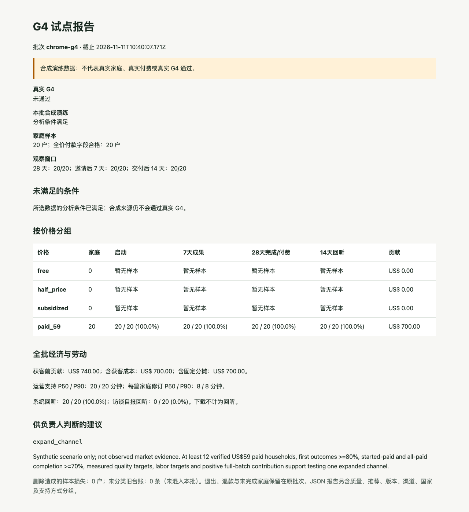

# G4 试点工程交付与本地验收

G4 的本地工程范围已完成：可追账的试点录入、版本历史、成熟窗口分析、分组经济与质量报告、删除和恢复保护，以及实际 Chrome 查看/导出报告。**这不代表真实纵向试点通过。** 当前实测来源均是合成夹具，真实报告仍为 `g4GateReady=false`。

整体本地工程进度从约92%推进至本轮定义范围的100%。依据总计划T00–T13工程估时中值82.5人日，G4/T13约6.5人日，占约8%。这是计划权重估算；不包含真实20–30户招募与完整观察、正式付费、供应商资格或生产发布，不能用于宣称整体产品已上线。

## 本批结果

- 管理端可实际录入带来源的观察快照，更正保留旧版、操作者和原因。数据库保证请求幂等、并发版本冲突、家庭身份稳定和名册关闭后不再加户。原型、AI保留集、纵向试点及四种价格分别报告。
- 首次成果从发出邀请开始计算；不接受邀请、退出和未完成家庭仍进入成熟分母。全价成交需实收5900美元分。20户只有1户启动成功不会再触发扩大建议。
- 工时按家庭和逐篇分别统计，并核对两者合计；未知工时不算零分钟。全批经济包含免费/未完成/退款家庭、人工显式费率、CAC、履约、托管准备及固定成本分摊；资料不齐时贡献为null。
- 质量由可追溯计数表达，报告核听错误、无效来源、植入检出、误报和严重未解决问题；仅勾“已审阅”不足以扩大。无成果的成熟批次可以记录真实零质量样本并形成需求/启动摩擦建议，不要求编造评测。
- 实际项目删除或G1故事软清除会连同所有试点证据版本删除；批次仅剩匿名损失数，防止只统计存活成功样本。双向并发和备份恢复墓碑回放均已实测。
- 静态HTML报告、JSON报告和服务器脚本可直接使用，管理凭证只从环境读取。操作入口、字段、例子与金额小计局限见[操作说明](../pilot-cohort.md)。

## 验证

| 检查 | 本轮结果 |
|---|---|
| G4完整迁移＋原生数据库＋Chrome＋备份恢复 | **667项断言通过**；bootstrap＋36迁移，共37文件；无受测源码漂移，临时数据库与连接清理成功 |
| 实际数据入口与报告 | 20户完整合成记录、重复/冲突、真实/合成隔离、普通凭证拒绝、1001户完整分母、实际CLI保存HTML |
| G1清除联动 | 写先/删先两种实际锁等待；历史证据均不复活。实际dump/restore后重放墓碑，试点证据清空并显示损失数 |
| G3完整回归 | **672项断言通过**，实际Chrome审阅、检索、PDF/ZIP、播放和测试支付行为未回退 |
| G4定向测试 | **4套/120项通过** |
| `npm run verify` | **181套/3717项Web测试通过**；类型、lint、**187页构建**通过 |
| shared / infra | **4套/16项**；**28项**通过 |
| 独立审查 | 规范PASS、代码Approved；5项初审发现与后续未知工时问题均已关闭，未留P0/P1/P2 |

首次infra运行因固定迁移清单未列出新迁移失败，补充清单后28项通过。首次组合备份运行因旧测试假设“数据库无先前删除请求”失败，改成保留和校验冻结前请求数、按本次删除ID核对目标后通过；两次失败日志保留。最终运行与[证据回执](evidence/2026-11-11-g4-pilot/verification.json)关联，不用旧失败运行作为成功证据。

## 交付边界与下一步

当前是运营核对后录入的证据台账；软件不自动验证外部账单或访谈，也不自动采集录音/付款/回听事件。系统回听与访谈自报分别统计，下载不等于收听。当前支付仍为G3的test模式；真实商业结论没有生成。

有批准成果的批次采用保守质检样本门槛；真实招募、输入证据保留规则、产品范围、费用和试点研究设计仍需实际执行。真实G4必须有成熟observed队列和负责人判断。任何上线工作仍需完成G3后补的托管、供应商、真实支付/设备和运营资格核验；本批不部署、不远端迁移、不提交或推送。

当前分支 `codex/october-upgrade-p0`，HEAD仍为 `c0669e8058343f91deba8e468b03e4bf817b1ca5`。继承的G1–G3与本批G4全部保持未暂存，构建产生的next-env变动已恢复。详细日志、源码逐文件哈希和归档见[证据索引](evidence/2026-11-11-g4-pilot/README.md)。
